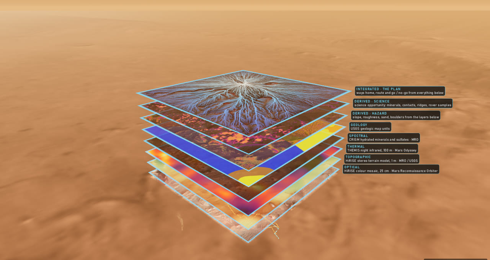
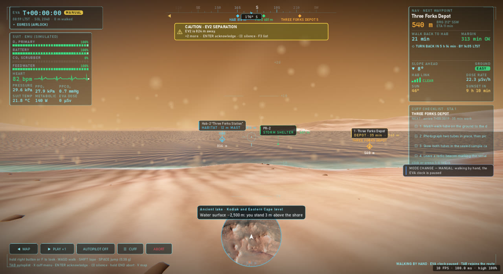
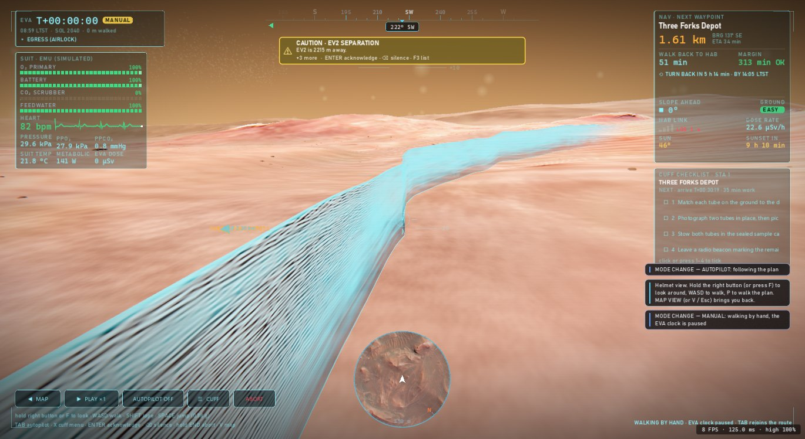
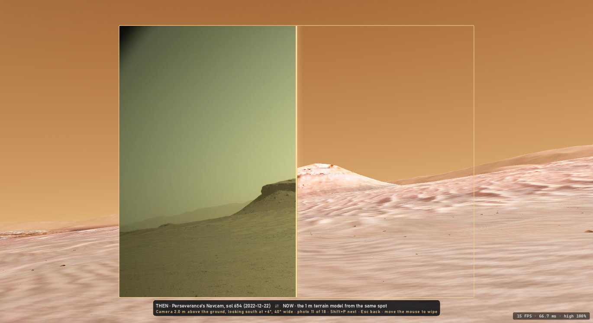

# Martian Map · EVA Navigator

**A map an astronaut can walk with.** Plan a Marswalk on real NASA terrain, see where the ground is safe, which
science is worth the walk, and how long you have before you must turn back.

NASA Space Apps Challenge 2026 · Challenge:
[*Interplanetary Survival Guide: Martian Map*](https://www.spaceappschallenge.org/2026/challenges/interplanetary-survival-guide-martian-map/)
· Team **Narayani Sena**

| Habitat console: planning the walk | Helmet HUD: walking the plan |
|---|---|
|  |  |

| Layer tower: the data lifts off the terrain | Flood the crater: Jezero's ancient lake |
|---|---|
|  |  |
| **Under the rover's track:** Perseverance's ground radar | **Then and now:** the rover's photo against our terrain |
|  |  |

## Summary

NASA's global tools, such as Mars Trek and the USGS-NASA geologic maps, show Mars region by region. A crew on a
Marswalk needs the opposite: one small patch of ground, metre by metre, with every source that matters for that
walk on one screen.

Martian Map is that map. You pick a site, a habitat and some science stops. The planner routes the walk over the
real 1 m HiRISE terrain while avoiding steep, rough and sandy ground and boulders. It simulates the suit's oxygen,
battery, CO₂ scrubber and cooling water minute by minute. It checks the sun, the weather, space weather, radiation
and radio coverage, then gives a **GO or NO-GO with the reasons**. The same plan then goes out with the crew: on the
habitat console, in the helmet HUD and on a printed cuff checklist.

## How it answers the brief

| The challenge asks for | Martian Map |
|---|---|
| A map, tool or interface a Mars astronaut could use on a surface mission | A web planner for the habitat (desktop, tablet or phone, with a one-minute guided tour), a native 3D console with a first-person helmet HUD, and an Apollo-style printable traverse sheet and cuff checklist |
| A science goal and a place to explore | Two real sites: the boxwork ridges of Mount Sharp in Gale crater, which Curiosity studied in 2025, and Perseverance's Three Forks sample depot in Jezero crater |
| Data from several NASA science missions, layered together | MRO (HiRISE, CTX, CRISM), Mars Odyssey (THEMIS), Curiosity, Perseverance, Ingenuity, NASA DONKI space weather, USGS geologic maps and ESA's HRSC terrain, in more than 20 map layers |
| At least three kinds of data | All eight the brief names: topographic, optical, thermal (night and day), spectral (minerals), chemical (rover laser chemistry), geophysical (ground-penetrating radar), atmospheric and radiation, plus geologic maps and space weather |
| Astronaut safety first | Walk-back time from every point, consumable margins, caution and warning built to NASA-STD-3001, radio coverage, terrain shadow and sunset, CME arrival windows, and tools for when something fails |
| Spacesuit mobility and carried equipment | Walking speed from Tobler's hiking function, scaled for a suited astronaut; speed and metabolic rate depend on the load carried |
| A route that avoids obstacles such as large rocks | Our own boulder detector on 25 cm HiRISE images finds about 4,400 boulders at Gale and 11,500 on Jezero's floor; boulders of 2 m or more are no-go, smaller ones cost time |
| Space weather and radiation | NASA DONKI's predicted CME arrivals at Mars are checked against the time in suits; Curiosity RAD dose rates; terrain shielding; a solar-storm drill |
| Point-of-view imagery | Then and now: the rover's own photos wiped against our terrain model from the exact pose they were taken at; arrival postcards that put a view rendered from the terrain beside the rover's photo of the same ground; Curiosity, Perseverance and Ingenuity photos at the places they were taken; and a first-person walk over the real terrain |
| Rovers and astronauts working in pairs | A pressurized rover (PR-2) as transport, safe haven and radio relay, and a two-person EVA with partner-down rescue times |

## What it does

### Plan the walk

* **Route planning** on a 2 m cost grid with directional A* (written for this project) and Dijkstra. The cost combines
  slope, metre-scale roughness, the chance of loose sand, and boulders.
* **Our own sand model.** THEMIS night IR (loose sand cools fast), HiRISE darkness and the USGS dune unit decide how
  much of each ~100 m patch is sand. Against Jezero's mapped bedforms it scores an AUC of 0.84 without using the map;
  a hand-tuned score reached 0.71.
* **Suit simulation**, minute by minute: oxygen, battery, CO₂ scrubber, cooling water, suit pressure, ppO₂ and
  inspired CO₂, for the planned walk and for the walk home from every point of it.
* **Science stop suggestions** from CRISM mineral signals, boundaries between geologic units, ridge crests and
  hollows, and rover sample sites. Each one says why it is there, for example "Clay ridge A: CRISM clays, ridge
  crest 1.0 m above its surroundings".
* **Rover-assisted EVA.** PR-2 drives the crew to a drop-off within its own limits (slopes up to 20°, around
  boulders of 1 m or more). On Gale this halves the walking (1.92 → 0.88 km) and cuts the time in suits from 162 to
  127 minutes.
* **Sunlight over the real terrain.** Every 4 m cell keeps its horizon, so sunrise, sunset and the stretches walked
  in shadow come from the real ridges. At the Gale habitat the sun is up 06:32-17:31 local solar time, against
  06:02-17:58 for a flat horizon.

### Stay safe

* **GO / NO-GO with reasons:** the return margin on the limiting consumable, CO₂ against NASA's 20 mmHg contingency
  limit, sunset, radio line of sight, terrain and space weather.
* **Caution and warning built to NASA-STD-3001 Volume 2:** four alert classes with NASA's colours and tones, latched
  alerts, silence, shelve and inhibit, spoken warnings, an event log and an alarm test. The console watches 28
  conditions and shows the turn-back time. See [docs/NASA_STANDARDS.md](docs/NASA_STANDARDS.md).
* **Uncertainty shown:** the return margin as a range under planning dispersions, how far the sand clues agree, and
  how far two independent terrain models agree, on the map and along the route.
* **Where each layer comes from.** Every map layer carries a tag: MEASURED (an instrument reading), MAPPED (drawn or
  published by scientists), DERIVED (geometry on measurements), MODELED (our model, with its limits stated) or RULE
  (decided by the limits you set), so an instrument reading is never mistaken for a model.
* **Space weather in the plan:** each DONKI forecast counts as a ±12 h window. A full hit during the EVA is NO-GO,
  and the planner offers the first start that clears every window and still ends before sunset.

### When something breaks

* **Ways home.** The fastest walk back from every point, drawn as one network that flows to the habitat like rivers.
  It shows the gateways where many ways home merge (six on Gale, 24-67 minutes out) and the ground with no way home.
  Click anywhere to trace your way back.
* **Shrinking world, a suit-leak drill.** The ground still in reach as oxygen runs down. With a leak at Ridge Alpha,
  120 minutes of oxygen leaves 194 ha in reach, and below about 52 minutes the habitat itself is out of reach. In the
  3D console's leak drill the crew is on 30 minutes of secondary oxygen: the ground they can no longer get home from
  dims red behind a glowing edge that tightens as the minutes run, and the visor says which havens are in reach.
* **Partner down.** The worst point of the route for an injured partner, and the time to get them to pressure: 21
  minutes at worst on the default Gale route, with PR-2.
* **Emergency caches.** Three oxygen caches at the gateways raise the share of the site within 30 minutes of a safe
  haven from 17 % to 72 %.
* **Skyline fix.** Where am I with no GPS? The helmet's view of the horizon is matched against the terrain model.
  The median error is 4 m on Gale and 14 m on Jezero's flat floor.
* **Fallback card and radio grid.** A printable card for a dead HUD, and grid references ("Kilo seven") to say where
  you are over the radio.
* **HUD-failure drill.** In the helmet the visor goes dark: no route, beacons or labels, only a paper card with the
  heading home, the pace count, where your shadow and the sun fall on a clock face, a named landmark on the skyline
  and the habitat's grid square. Ask the skyline for a fix if you are lost; at the door the walk is scored.

### Plan smarter

* **Plan it for me.** Give a time in suits and get three EVAs (safe, balanced, bold) that collect the most science
  inside the margins, with the stops in the best order, each planned for real. At the same 162 minutes in suits as
  the hand-picked Gale EVA it finds 1.3 times the science (1.4 times at Jezero), and all three come out GO.
* **Scout first.** It finds the stretches where GO rests on uncertain data (the two terrain models disagree, or the
  sand clues do), plans a helicopter flight over them, as Ingenuity scouted for Perseverance's drivers, and shows the
  plan again with the uncertainty narrowed. The flight's result is simulated, and the app says so.
* **Crew-tagged map.** Look at a spot and press once: a hazard tag closes that ground and the route is planned again;
  a find becomes a candidate stop.
* **The cost of a rock.** Samples add mass as the EVA goes on, so each one has a price in minutes of margin. The EVA
  ends with a debrief page: walked against planned, time at each station, and a passport for every sample.
* **Beat the planner.** Sketch your own route; it is scored with the same walking model and raced against A*.
* **Pace notes and a strip map.** Each leg unrolled as a straight strip with boulders (on their side, to scale),
  turns, climbs, radio shadow and terrain shadow at their distances, and a co-driver voice that reads the notes
  aloud ("350 m: 3.7 m boulder right, keep left, then left 45°").
* **Sun in your eyes.** Minutes walking into a low sun (glare in the visor) or with the sun straight behind (flat
  light that hides the relief), with the same loop walked the other way as an alternative.

### See the data together

* **Layer tower.** The map's data layers lift off the ground as a 3D stack, each labelled with its mission and
  instrument, and a needle reads one point through every layer. In the 3D console it is the TOWER button and the
  opening shot of the demo.
* **Flood the crater.** Jezero's ancient lake at the levels published by Mangold et al. (2024). At −2,500 m, 57 % of
  the site is under water, 46 m over the habitat. In the 3D console the water rises through the published levels as
  one body of water (the low plains outside the crater rim stay dry), the lake bed shows through the shallows, and in
  the helmet the visor gives the metres of water overhead.
* **Habitat and suit, live.** The 3D console's helmet streams EV1's position, suit and alerts to the web planner's
  habitat console twice a second, and a crew member inside can push a waypoint or a message into the visor. Earth,
  11 light-minutes away today, sees the same walk one light-time late.
* **Earth link.** Sun, Earth and Mars where they are today, CMEs on their way, the light-time delay (11 minutes each
  way today) and an "Ask Earth" exchange that waits for the real delay.
* **Ingenuity at Jezero.** The helicopter's 24 flights over the site at their altitude, the ground its camera saw,
  and its photos for each flight.
* **The rover teams' own terrain models,** lined up with ours by phase correlation, so the rovers' tracks, samples
  and colour mosaics sit on the right ground. Rover heights now match our terrain within half a metre.
* **Geologist's white balance.** One switch shows the ground, the 3D view and the rover photos in Earth-like light,
  so rock colours read as they would at home (the rover teams publish both natural and white-balanced colour).
* **The sound of the site.** At Jezero, the wind as Perseverance's SuperCam microphone recorded it on sol 4. Curiosity
  carries no microphone, so at Gale the app says the wind has never been heard rather than inventing it.
* **What the rocks are made of.** The rovers' laser chemistry at their targets inside each site, from the NASA
  Planetary Data System: 462 ChemCam targets at Gale and 204 SuperCam targets at Jezero, as pins with oxide bars
  (SiO₂, FeO, MgO, CaO and more). Each pin sits where the rover stood that sol, and the point inspector shows the
  nearest targets, so a stop says what its rock is made of.
* **Under the rover's track.** Perseverance's RIMFAX ground-penetrating radar sounded the ground every 10 cm as it
  drove. 53 sols of its radargrams (7 km of track inside the Jezero site, from the NASA Planetary Data System) are laid
  along the drives: click a track in the web planner to see 5 m down, with the cursor following on the map, or press
  Shift+J in the 3D console to hang them under the track as a curtain you see through the ground. Light and dark bands
  are buried layer boundaries; the chevrons are echoes off buried rocks.

### Take it with you

* **Then and now.** Press Shift+P in the 3D console to stand exactly where the rover's navigation camera stood,
  looking where it looked (from the camera model and rover attitude in NASA's raw-image feeds), and wipe between the
  rover's photo and our terrain model rendered from the same spot. It shows what the crew will see there, and how
  well the map matches the real ground. In the web planner the same photos are view cones on the map: hover for the
  photo, click to open it.
* **Arrival postcards.** For each stop, the view a few steps before arriving, rendered from the HiRISE terrain and
  colour for the arrival time and sun (with Mount Sharp on the horizon at Gale), beside the rover's own navigation-
  camera photo from the nearest place it stood.
* **Mission patch.** A patch for each EVA drawn from the route's own shape, with the site, the sol and the crew's
  names; it is printed on the traverse sheet and stamped on the postcards.
* **Touch the map.** The site as a 3D-printable block (closed STL, 150 mm) with the route raised as a ridge and the
  stops as bumps, and as a textured GLB for 3D viewers and phone AR.
* **Walk it on Earth.** On a phone, walk the EVA at full scale on a sports field: GPS moves your dot across the Mars
  site with the walk-back time live, and the route can be saved as a GPX laid over your own neighbourhood. Your
  position stays in the browser. `run_web.ps1 -Lan` serves the planner over HTTPS on your Wi-Fi, which phones
  require before they share GPS.

### Two clients

* **Web planner** (React, Leaflet, three.js) for desktop, tablet and phone, in the habitat. A one-minute guided tour
  starts on the first visit (TOUR in the top bar, or `?tour` in the address); on a phone the panels open as sheets
  over the map.
* **3D console** (Godot 4.7): orbit view for planning, first-person helmet HUD for walking, the moving rover, a
  hold-to-confirm ABORT that walks the crew home, glove mode and a cuff menu for suited hands, gamepad and offline
  voice commands, a guided tour and a hands-free demo. It runs at 25-30 FPS on an Intel UHD 620 laptop.
* **Helmet tools** in the 3D console: a ghost astronaut that walks the plan at the planned pace (K), a data
  flashlight that shows a layer only where you look (O), synthetic vision with glowing contours and snow poles
  every 50 m for dust or flat light (N), Earth light (B), hazard and find tags where you look (T), co-driver pace
  notes read aloud, Geiger clicks from the dose rate and a detector tone over science ground, the HUD-failure drill
  (U), the skyline fix (Y), the ancient lake (I), the ground radar curtain (Shift+J) and then-and-now (Shift+P).

## Built on NASA data

| Mission or source | Data | Used for |
|---|---|---|
| MRO HiRISE (NASA/JPL/University of Arizona, via USGS Astrogeology) | 1 m terrain models, 25 cm orthoimages, colour mosaics | Terrain, slope, roughness, boulders, routing, 3D scene |
| MRO CTX (JPL MMGIS) | Colour mosaics | Basemap |
| MRO CRISM (PDS Geosciences Node, ODE REST) | MTRDR mineral products | Mineral layers, science stops |
| Mars Odyssey THEMIS (ASU, USGS, NASA Mars Trek) | Night IR mosaics, day IR | Sand model, thermal layers |
| Curiosity | REMS weather, RAD dose rates, traverse, raw images; MSL Gale merged DEM mosaic (Parker & Calef, USGS) | Climate calibration, radiation, rover track, ground photos, terrain cross-check |
| Perseverance | MEDA weather, traverse, sample sites, raw images; Mars 2020 TRN HiRISE DTM mosaic (Fergason et al. 2020, USGS) | Sample-depot site, science stops, terrain cross-check |
| Ingenuity (JPL MMGIS, mars.nasa.gov) | Flight paths, waypoints, raw images | Flights layer, scouted ground, photos |
| USGS-NASA Planetary Geologic Mapping Program | SIM 3464 (Sun & Stack 2020), SIM 3292 (Tanaka et al. 2014) | Geologic unit layer and descriptions |
| NASA CCMC DONKI | CME analyses and predicted arrivals at Mars | Space weather in the plan, Earth link |
| NASA GISS Mars24 | Mars time and sun position | Sol, local solar time, sun path |
| ESA / DLR / FU Berlin (Space Agency Partner) | HRSC-MOLA blended terrain model | Regional terrain and far horizon |
| Curiosity ChemCam and Perseverance SuperCam (PDS Geosciences Node) | LIBS major-oxide compositions per target | Rover chemistry pins, point inspector |
| Mangold et al. (2024) | Jezero lake levels | Flood-the-crater layer |
| Perseverance SuperCam microphone (NASA/JPL-Caltech/LANL/CNES/CNRS/ISAE-Supaero) | Wind recording, sol 4 | The sound of Jezero |
| Perseverance RIMFAX (PDS Geosciences Node; Hamran et al. 2020) | Calibrated ground-penetrating radar radargrams, 53 sols | Radar curtain under the rover's track |

All of these are public products. The site pipeline downloads and caches them. All suit, walking and rover numbers
are planning assumptions and are shown in the app.

## How we checked it

* **Against the rovers' own drives.** A rover only drives where its team judged the ground safe, so its track is
  ground known to be crossable. Curiosity drove 4.9 km inside the Gale site and Perseverance 9.1 km inside the
  Jezero site; our walking map calls 97.8 % and 99.8 % of those tracks passable (99.8 % and 100 % within 2 m,
  allowing for position error), and no-go ground is 8 and 18 times rarer under the wheels than across each site.
  The web planner shows the check under Data & method, and it follows the walking limits you set.
* **CRISM lined up with HiRISE.** As the archive places them, CRISM's map-projected mineral products sit 140-310 m
  off the HiRISE terrain (136-222 m at Gale, 209-311 m at Jezero): their correlation with the HiRISE mosaic is about
  0. Each observation's true-colour image is now phase-correlated with the HiRISE mosaic at 16 m, and the shift is
  applied to its mineral layers (correlation 0.31-0.52 after), so the minerals and the science score built on them
  sit on the right ground. A shift is used only when it clearly improves the match.
* The sand model was tested against Jezero's mapped bedforms: AUC 0.84, and it flags 1 % of non-dune ground
  instead of 60 %.
* The rover teams' terrain models line up with ours within half a metre after the shift found by phase correlation
  (12 m and 5 m off before).
* The skyline fix is scored on 1,000 random points of each site.
* Planet positions match the January 2025 Mars close approach, and the Mars clocks are cross-checked against
  Mars24.
* The default plans for both sites are GO. A pytest suite covers routing, the suit model, the rover, boulders, CRISM,
  weather, Mars time, the emergency tools, the lake, the exports and the site configs. The 3D console has scripted
  check tours, including 25 NASA-standards checks and checks for every helmet tool, the lake, the layer tower, the
  live link, the radar curtain and then-and-now (`-- --tour=tools | lake | tower | live | radar | thennow`).
* Then and now is checked against the rovers' own headings: a frame's pointing from the camera model and attitude
  agrees with the waypoint's heading plus the mast's azimuth to within a degree or two.
* Each radar sol is kept only when its radargram's length matches the rover's drive that sol within 15 %.

## Sites

| Site | Rover | Story |
|---|---|---|
| **Gale crater · Mount Sharp boxwork** (`gale_boxwork`) | Curiosity | Sample a mineral-cemented boxwork ridge and two sandy hollows that Curiosity explored in 2025 |
| **Jezero crater · Three Forks sample depot** (`jezero_threeforks`) | Perseverance | Recover two of the ten sample tubes Perseverance left at Three Forks, then visit Wildcat Ridge (organic-bearing lake mudstone) and the Amalik outcrop on the delta front |

| Default plan | Walking from the habitat | With the pressurized rover PR-2 |
|---|---|---|
| Gale | 1.92 km walked · 162 min in suits · farthest walk-back 17.8 min · GO | 0.88 km walked + 1.25 km driven · 127 min in suits · walk-back 6.8 min · GO |
| Jezero | 2.57 km walked · 175 min in suits · farthest walk-back 22.5 min · GO | 1.40 km walked + 1.38 km driven · 140 min in suits · walk-back 8.9 min · GO |

Each site is one JSON file in `config/sites/`, so a new site is a new file and one pipeline run.

## Run it

Windows PowerShell, from this folder:

```powershell
python -m venv .venv; .venv\Scripts\pip install -r requirements.txt
.venv\Scripts\python -m pipeline.build_site gale_boxwork        # builds the site data: about 25 min the first time, cached after
.venv\Scripts\python -m pipeline.build_site jezero_threeforks
.\run_web.ps1                                                    # web planner: builds web/dist when needed, starts the API, opens http://localhost:8000
.\run_web.ps1 -Lan                                               # the same over HTTPS for phones on your Wi-Fi (port 8443, self-signed certificate)
.\run_godot.ps1                                                  # 3D console (finds Godot 4.7 via $env:GODOT or PATH)
.\run_godot.ps1 -Trailer -Site jezero_threeforks                 # record the hands-free demo to trailer\ (MP4 with ffmpeg)
.\run_godot.ps1 -Trailer -Short -Site jezero_threeforks          # the 30-second cut for a Space Apps demo video
.venv\Scripts\python -m pytest -q                                # tests
```

For development, run the API with `.venv\Scripts\python -m uvicorn server.main:app --port 8000` and the web planner
with `cd web; npm install; npm run dev` (http://localhost:5173). The built site data (`data/`) is not stored in the
repository; the pipeline downloads and builds it.

## Layout

```
config/sites/   site definitions (area, terrain models, basemaps, rover feeds, habitat, stops, shelters)
pipeline/       builds a site: terrain mosaic, slope and roughness, rover-team terrain and its offset, sky view and
                horizon, imagery, THEMIS, CRISM, geology, boulders, sand model, terrain confidence, rover track,
                Ingenuity, rover chemistry, science score, contours
marsgeo/        shared library: Mars time, site grids, STAC search, map tiles, HTTP session
server/         FastAPI: plans, routes, walk-back, ways home, emergency tools, viewshed, conditions, weather,
                space weather, tiles, traverse sheet, live habitat link
web/            React + Leaflet planner (Vite)
godot/          Godot 4.7 3D EVA console (see godot/README.md)
tests/          pytest suite
docs/           NASA standards notes
```

## Status

Everything described above works and has been checked, in the web planner and in the 3D console.

## Disclaimer

An educational project made for the NASA Space Apps Challenge 2026. It is not an operational tool, and it is not a
NASA product or endorsed by NASA.

© 2026 Team Narayani Sena. All rights reserved.
