<div align="center">

# Martian Map · EVA Navigator

### A map an astronaut can walk with

Plan a Marswalk on real NASA terrain. See where the ground is safe, which science is worth the walk,<br>
and how long you have before you must turn back. Then walk the plan behind a helmet HUD.


**NASA Space Apps Challenge 2026** · Challenge:
[*Interplanetary Survival Guide: Martian Map*](https://www.spaceappschallenge.org/2026/challenges/interplanetary-survival-guide-martian-map/)
· Team **Narayani Sena**

[**▶ 30-second demo**](https://youtu.be/ct01SFMZwIY) &nbsp;·&nbsp;
[**▶ Full tour, 7 minutes**](https://youtu.be/6IOXLmkR9Fc) &nbsp;·&nbsp;
[What it does](#what-it-does) &nbsp;·&nbsp;
[NASA data](#built-on-nasa-data) &nbsp;·&nbsp;
[How we checked it](#how-we-checked-it) &nbsp;·&nbsp;
[Run it](#run-it)

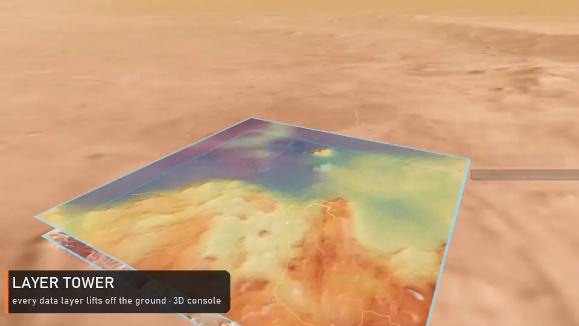

<sub>Every frame above is the real app, recorded from the 3D console and the web planner.</sub>

</div>

## Watch it

<table>
<tr>
<td width="50%" align="center" valign="top">
<a href="https://youtu.be/ct01SFMZwIY">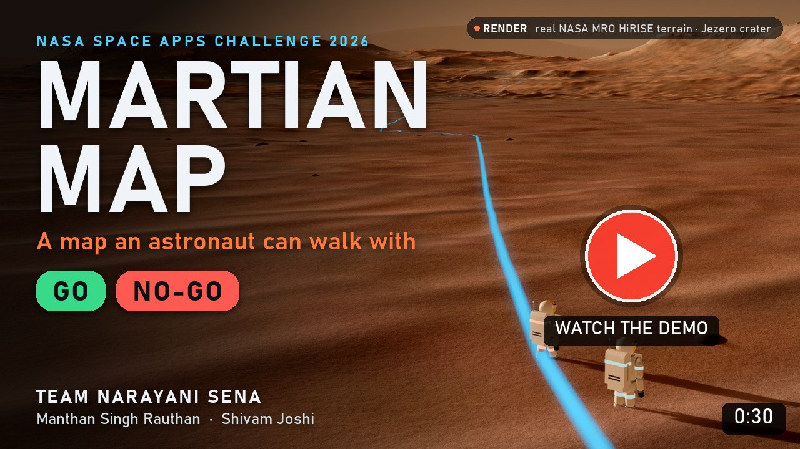</a>
<br><b><a href="https://youtu.be/ct01SFMZwIY">The 30-second demo</a></b>
<br><sub>The Space Apps demo video: what Martian Map is and what it does, in half a minute.<br>https://youtu.be/ct01SFMZwIY</sub>
</td>
<td width="50%" align="center" valign="top">
<a href="https://youtu.be/6IOXLmkR9Fc">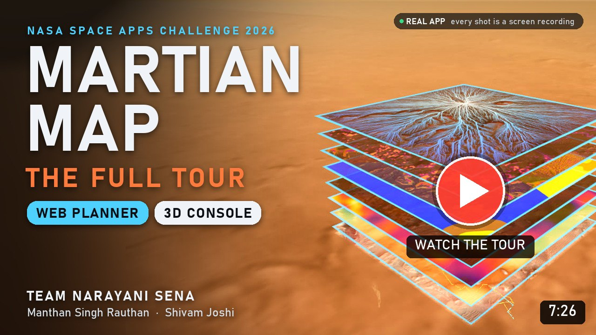</a>
<br><b><a href="https://youtu.be/6IOXLmkR9Fc">The full tour · 7:26</a></b>
<br><sub>Every feature of the web planner and the 3D console, with voice and captions. Screen recordings only.<br>https://youtu.be/6IOXLmkR9Fc</sub>
</td>
</tr>
</table>

**Chapters of the full tour:**
[0:19 The app](https://youtu.be/6IOXLmkR9Fc?t=19) ·
[0:49 Plan the walk](https://youtu.be/6IOXLmkR9Fc?t=49) ·
[2:01 Stay safe](https://youtu.be/6IOXLmkR9Fc?t=121) ·
[2:53 When something breaks](https://youtu.be/6IOXLmkR9Fc?t=173) ·
[3:48 Plan smarter](https://youtu.be/6IOXLmkR9Fc?t=228) ·
[4:24 See the data together](https://youtu.be/6IOXLmkR9Fc?t=264) ·
[5:30 Take it with you](https://youtu.be/6IOXLmkR9Fc?t=330) ·
[6:06 The 3D console](https://youtu.be/6IOXLmkR9Fc?t=366) ·
[6:53 How we checked it](https://youtu.be/6IOXLmkR9Fc?t=413)

A copy of the full tour is also kept in this repository: [docs/martian_map_full_tour.mp4](docs/martian_map_full_tour.mp4)
(1080p, 91 MB).

<sub>In both videos the wind is the real Mars recording from Perseverance's SuperCam microphone (sol 4), the music was
composed in code, and the narration is a text-to-speech voice. The 30-second demo also has renders made in Blender from
the app's own NASA data, each labelled RENDER on screen.</sub>

> [!TIP]
> **Short on time?** Watch the 30-second demo, then jump to the chapter you care about in the full tour.
> To try it yourself, `.\run_web.ps1` opens the web planner with a one-minute guided tour, and `.\run_godot.ps1` opens
> the 3D console, where **▶ DEMO** flies through a whole EVA by itself.

<details>
<summary><b>Contents</b></summary>

- [At a glance](#at-a-glance)
- [The idea](#the-idea)
- [How it answers the brief](#how-it-answers-the-brief)
- [What it does](#what-it-does)
  - [Plan the walk](#plan-the-walk)
  - [Stay safe](#stay-safe)
  - [When something breaks](#when-something-breaks)
  - [Plan smarter](#plan-smarter)
  - [See the data together](#see-the-data-together)
  - [Take it with you](#take-it-with-you)
- [Two clients, one plan](#two-clients-one-plan)
- [Built on NASA data](#built-on-nasa-data)
- [How we checked it](#how-we-checked-it)
- [Limits](#limits)
- [Sites](#sites)
- [How it works](#how-it-works)
- [Run it](#run-it)
- [Reference](#reference): every feature, every map layer, controls, alerts, the API
- [Built with](#built-with)
- [Layout](#layout)
- [Team and credits](#team-and-credits)

</details>

## At a glance

<table>
<tr>
<td width="25%" align="center" valign="top"><b>2 real sites</b><br><sub>Gale and Jezero, each about 3.2 × 3.3 km at 1 m</sub></td>
<td width="25%" align="center" valign="top"><b>27 + 16 map layers</b><br><sub>raster and vector, each tagged with where it comes from</sub></td>
<td width="25%" align="center" valign="top"><b>8 of 8 kinds of data</b><br><sub>every kind the challenge brief names</sub></td>
<td width="25%" align="center" valign="top"><b>5 NASA missions</b><br><sub>MRO, Mars Odyssey, Curiosity, Perseverance, Ingenuity</sub></td>
</tr>
<tr>
<td align="center" valign="top"><b>97.8 % and 99.8 %</b><br><sub>of Curiosity's and Perseverance's own drives are walkable on our map</sub></td>
<td align="center" valign="top"><b>15,900 boulders</b><br><sub>found by our own detector in 25 cm HiRISE images</sub></td>
<td align="center" valign="top"><b>666 rock targets</b><br><sub>with laser chemistry from ChemCam and SuperCam</sub></td>
<td align="center" valign="top"><b>7 km of ground radar</b><br><sub>53 sols of Perseverance's RIMFAX</sub></td>
</tr>
<tr>
<td align="center" valign="top"><b>28 alert conditions</b><br><sub>caution and warning built to NASA-STD-3001</sub></td>
<td align="center" valign="top"><b>203 automated tests</b><br><sub>plus scripted check tours of the 3D console</sub></td>
<td align="center" valign="top"><b>68 API endpoints</b><br><sub>one FastAPI backend for both clients</sub></td>
<td align="center" valign="top"><b>2 clients</b><br><sub>a web planner and a 3D console with a helmet HUD</sub></td>
</tr>
</table>

## The idea

NASA's global tools, such as Mars Trek and the USGS-NASA geologic maps, show Mars region by region. A crew on a
Marswalk needs the opposite: one small patch of ground, metre by metre, with every source that matters for that
walk on one screen.

Martian Map is that map. You pick a site, a habitat and some science stops. The planner routes the walk over the
real 1 m HiRISE terrain while avoiding steep, rough and sandy ground and boulders. It simulates the suit's oxygen,
battery, CO₂ scrubber and cooling water minute by minute. It checks the sun, the weather, space weather, radiation
and radio coverage, then gives a **GO or NO-GO with the reasons**. The same plan then goes out with the crew: on the
habitat console, in the helmet HUD and on a printed cuff checklist.

Other maps tell the astronaut where to walk. This one also shows every way home, says where it may be wrong, and
still works when something breaks.

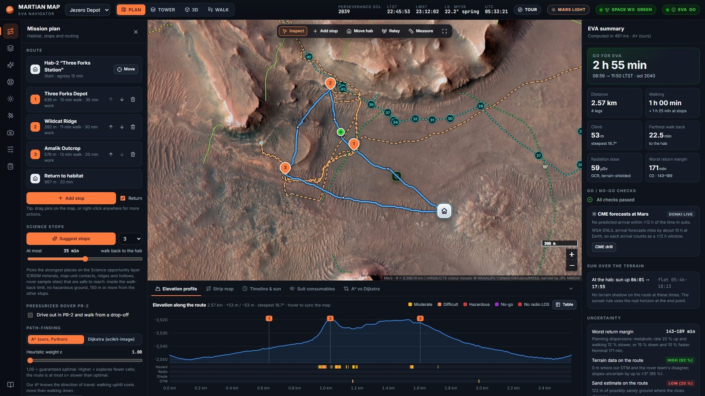

<sub><b>The web planner</b>, at Perseverance's Three Forks sample depot in Jezero crater: the mission plan (left), the
route on the HiRISE mosaic (centre), the EVA summary with its GO verdict (right) and the elevation profile (bottom).</sub>

## How it answers the brief

| The challenge asks for | Martian Map |
|---|---|
| A map, tool or interface a Mars astronaut could use on a surface mission | A web planner for the habitat (desktop, tablet or phone, with a one-minute guided tour), a native 3D console with a first-person helmet HUD, and an Apollo-style printable traverse sheet and cuff checklist |
| A science goal and a place to explore | Two real sites: the boxwork ridges of Mount Sharp in Gale crater, which Curiosity studied in 2025, and Perseverance's Three Forks sample depot in Jezero crater |
| Data from several NASA science missions, layered together | MRO (HiRISE, CTX, CRISM), Mars Odyssey (THEMIS), Curiosity, Perseverance, Ingenuity, NASA DONKI space weather, USGS geologic maps and ESA's HRSC terrain, in up to 27 raster and 16 vector map layers per site |
| At least three kinds of data | All eight the brief names: topographic, optical, thermal (night and day), spectral (minerals), chemical (rover laser chemistry), geophysical (ground-penetrating radar), atmospheric and radiation, plus geologic maps and space weather |
| Astronaut safety first | Walk-back time from every point, consumable margins, caution and warning built to NASA-STD-3001, radio coverage, terrain shadow and sunset, CME arrival windows, and tools for when something fails |
| Spacesuit mobility and carried equipment | Walking speed from Tobler's hiking function, scaled for a suited astronaut; speed and metabolic rate depend on the load carried |
| A route that avoids obstacles such as large rocks | Our own boulder detector on 25 cm HiRISE images finds about 4,400 boulders at Gale and 11,500 on Jezero's floor; boulders of 2 m or more are no-go, smaller ones cost time |
| Space weather and radiation | NASA DONKI's predicted CME arrivals at Mars are checked against the time in suits; Curiosity RAD dose rates; terrain shielding; a solar-storm drill |
| Point-of-view imagery | Then and now: the rover's own photos wiped against our terrain model from the exact pose they were taken at; arrival postcards that put a view rendered from the terrain beside the rover's photo of the same ground; Curiosity, Perseverance and Ingenuity photos at the places they were taken; and a first-person walk over the real terrain |
| Rovers and astronauts working in pairs | A pressurized rover (PR-2) as transport, safe haven and radio relay, and a two-person EVA with partner-down rescue times |

## What it does

Six chapters, in the same order as the [full tour](https://youtu.be/6IOXLmkR9Fc). Click any picture to see it full size.

### Plan the walk

<table>
<tr>
<td width="33%" valign="top">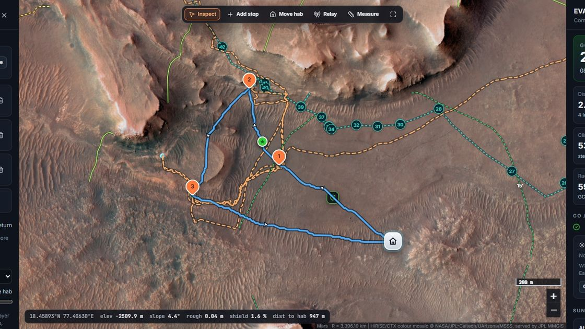<br><b>Route planning</b><br><sub>The walk routed over 1 m HiRISE terrain by our own directional A*, with the walk-back rings and Perseverance's track.</sub></td>
<td width="33%" valign="top">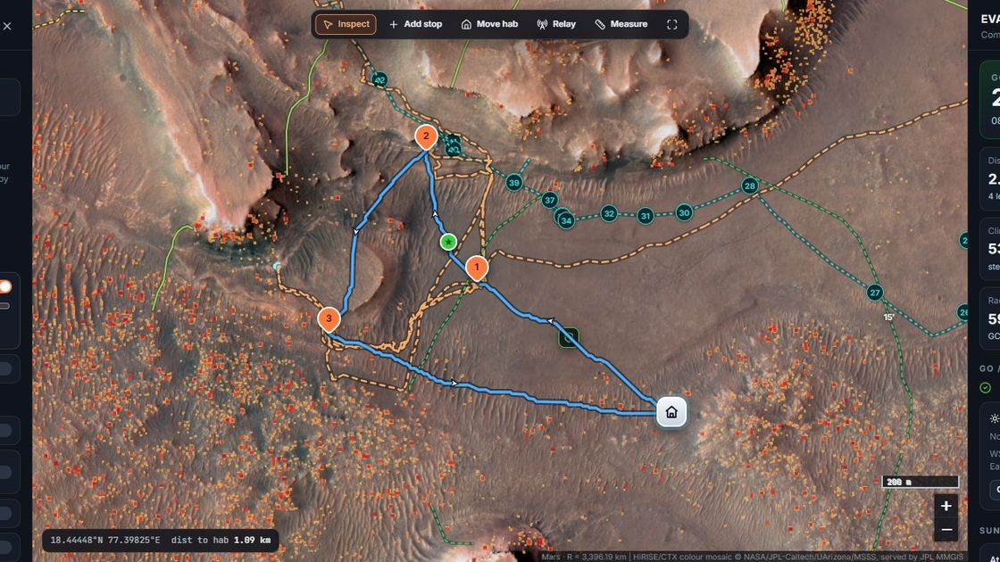<br><b>Boulders</b><br><sub>About 11,500 boulders found on Jezero's floor by our shadow detector on 25 cm HiRISE. Two metres and over is no-go.</sub></td>
<td width="33%" valign="top">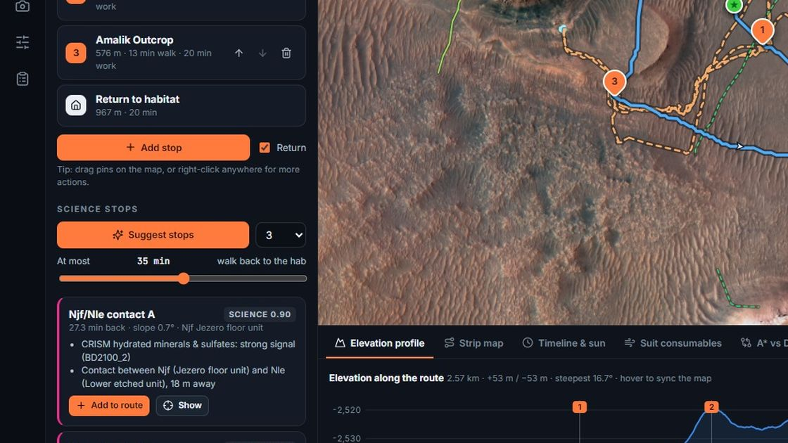<br><b>Science stop suggestions</b><br><sub>Each suggested stop says why it is there: a strong CRISM signal, a contact between two map units, a ridge crest.</sub></td>
</tr>
<tr>
<td width="33%" valign="top">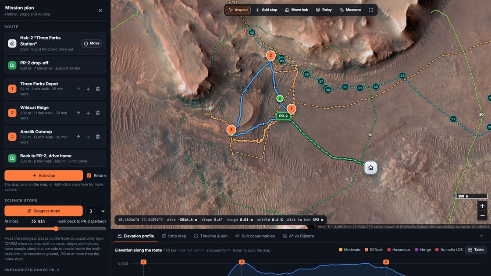<br><b>Rover-assisted EVA</b><br><sub>PR-2 drives the crew out (green) to a drop-off it chose itself. The parked rover is the safe haven and a radio relay.</sub></td>
<td width="33%" valign="top">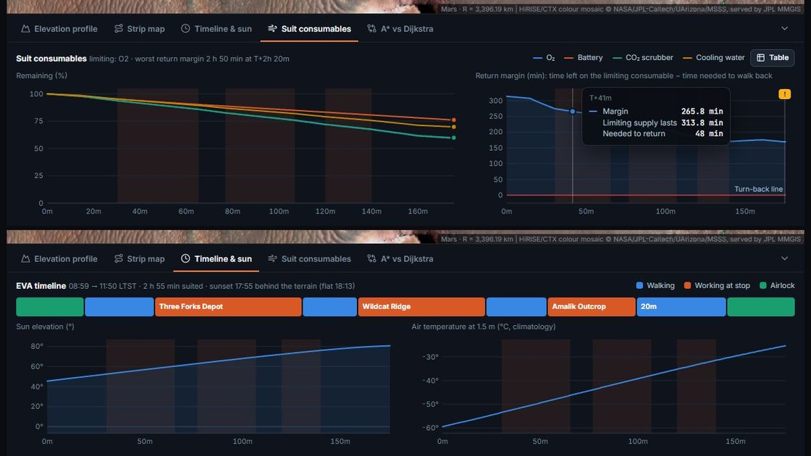<br><b>Suit, timeline and sun</b><br><sub>Oxygen, battery, CO₂ scrubber and cooling water over the EVA, the return margin, and the sun over the timeline.</sub></td>
<td width="33%" valign="top">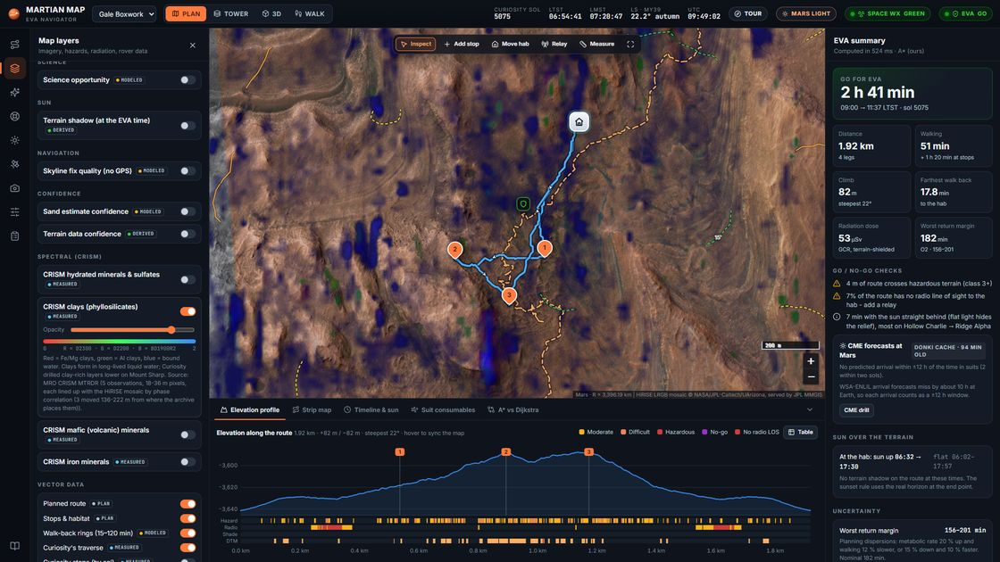<br><b>Minerals from orbit</b><br><sub>CRISM clays over the boxwork at Gale, lined up with HiRISE. The science score and the suggested stops are built on them.</sub></td>
</tr>
</table>

* **Route planning** on a 2 m cost grid with directional A* (written for this project) and Dijkstra. The cost combines
  slope, metre-scale roughness, the chance of loose sand, and boulders. Walking uphill costs more than walking down.
  An A* against Dijkstra tab runs both on one leg and scores them with the same walking model.
* **Our own sand model.** THEMIS night IR (loose sand cools fast), HiRISE darkness and the USGS dune unit decide how
  much of each ~100 m patch is sand. Against Jezero's mapped bedforms it scores an AUC of 0.84 without using the map;
  a hand-tuned score reached 0.71.
* **Suit simulation**, minute by minute: oxygen, battery, CO₂ scrubber, cooling water, suit pressure, ppO₂ and
  inspired CO₂, for the planned walk and for the walk home from every point of it. At every moment the suit must hold
  enough to walk back, times a tired-return factor, plus a fixed reserve.
* **Science stop suggestions** from CRISM mineral signals, boundaries between geologic units, ridge crests and
  hollows, and rover sample sites. Each one says why it is there, for example "Clay ridge A: CRISM clays, ridge
  crest 1.0 m above its surroundings".
* **Rover-assisted EVA.** PR-2 drives the crew to a drop-off within its own limits (slopes up to 20°, around
  boulders of 1 m or more). On Gale this halves the walking (1.92 → 0.88 km) and cuts the time in suits from 162 to
  127 minutes.
* **Sunlight over the real terrain.** Every 4 m cell keeps its horizon, so sunrise, sunset and the stretches walked
  in shadow come from the real ridges. At the Gale habitat the sun is up 06:32-17:31 local solar time, against
  06:02-17:58 for a flat horizon.
* **Everything is adjustable.** Walking speed, slope and roughness limits, sand penalty, carried equipment, hazard
  aversion, oxygen, battery, scrubber, cooling water, reserve, return factor and airlock time are sliders. The start
  time, the stops, their tasks and the radio relays are yours to set, and every change plans the whole EVA again in
  about a second.
* **Inspect any point.** Click the map for everything known there: grid square, elevation, slope, roughness, hazard
  class, sand and why, walk-back time, radio, shielding and dose rate, THEMIS, the USGS map unit, how sure the data
  is, the science score with its reasons, sunrise and sunset over the terrain, the nearest rock chemistry, the radar
  under the ground, and a link to NASA Mars Trek.

### Stay safe

<table>
<tr>
<td width="33%" valign="top">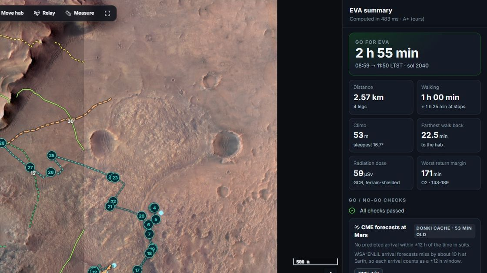<br><b>GO, with the numbers</b><br><sub>Distance, climb, farthest walk back, dose and the worst return margin on the limiting consumable.</sub></td>
<td width="33%" valign="top">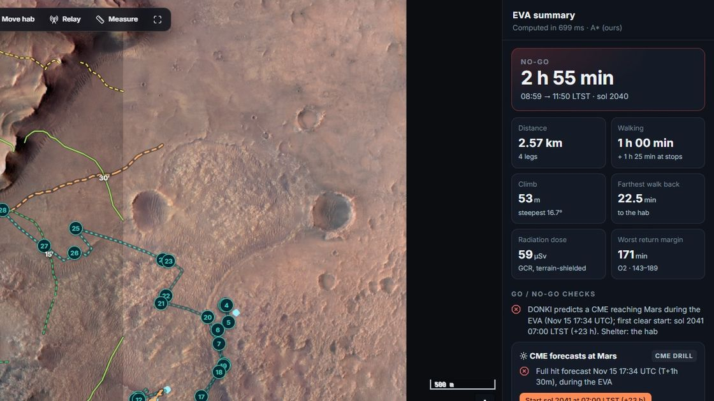<br><b>NO-GO, with the reason</b><br><sub>A CME due at Mars during the EVA turns the plan NO-GO, and the planner offers the first start that is clear.</sub></td>
<td width="33%" valign="top">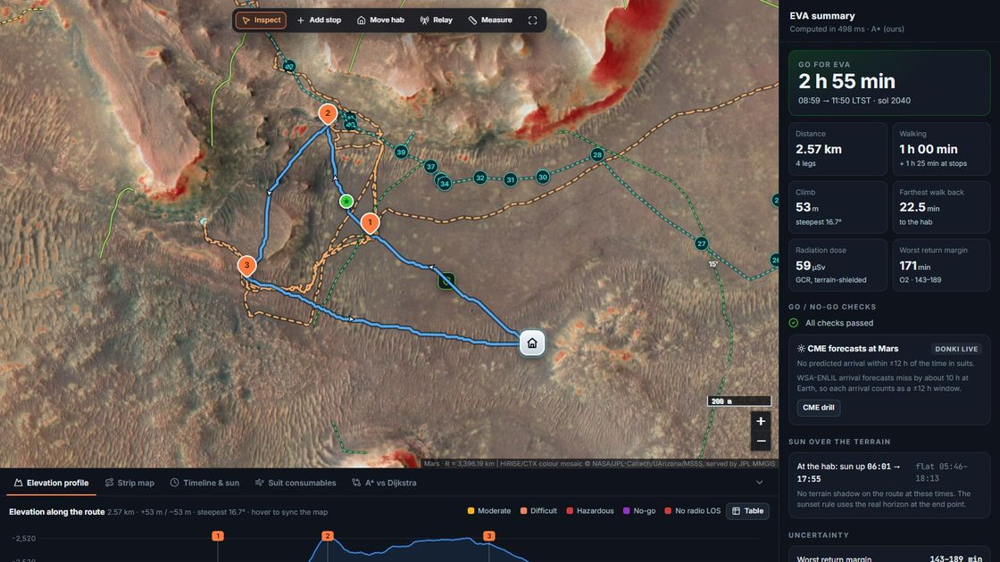<br><b>Uncertainty shown</b><br><sub>The margin as a range, and in red the ground where our terrain model and the rover team's disagree.</sub></td>
</tr>
<tr>
<td width="33%" valign="top">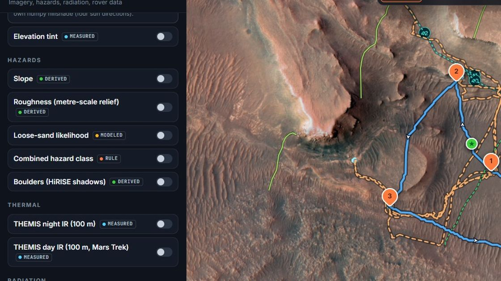<br><b>Where each layer comes from</b><br><sub>MEASURED, MAPPED, DERIVED, MODELED or RULE on every layer, so a model is never mistaken for a measurement.</sub></td>
<td width="33%" valign="top">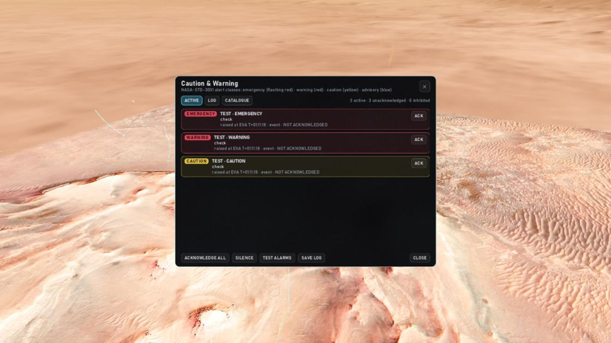<br><b>Caution and warning</b><br><sub>Four alert classes with NASA's colours and tones, a log, a catalogue of all 28 alerts, and an alarm test.</sub></td>
<td width="33%" valign="top">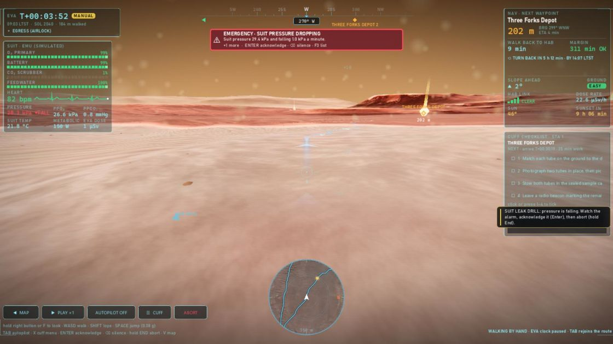<br><b>In the helmet</b><br><sub>A suit-leak drill: the emergency stays on the visor and keeps sounding until it is acknowledged.</sub></td>
</tr>
</table>

* **GO / NO-GO with reasons:** the return margin on the limiting consumable, CO₂ against NASA's 20 mmHg contingency
  limit, sunset, radio line of sight, terrain and space weather.
* **Caution and warning built to NASA-STD-3001 Volume 2:** four alert classes with NASA's colours and tones, latched
  alerts, silence, shelve and inhibit, spoken warnings, an event log and an alarm test. The console watches 28
  conditions and shows the turn-back time ("TURN BACK IN 38 min · BY 14:32 LTST"). See
  [docs/NASA_STANDARDS.md](docs/NASA_STANDARDS.md).
* **Uncertainty shown:** the return margin as a range under planning dispersions, how far the sand clues agree, and
  how far two independent terrain models agree, on the map and along the route.
* **Where each layer comes from.** Every map layer carries a tag: MEASURED (an instrument reading), MAPPED (drawn or
  published by scientists), DERIVED (geometry on measurements), MODELED (our model, with its limits stated) or RULE
  (decided by the limits you set), so an instrument reading is never mistaken for a model.
* **Space weather in the plan:** each DONKI forecast counts as a ±12 h window. A full hit during the EVA is NO-GO,
  and the planner offers the first start that clears every window and still ends before sunset. A what-if drill
  puts a CME 90 minutes into the EVA to show it.
* **Sun, weather and radiation.** The sun now and through the sol, a weather model calibrated with Curiosity's REMS,
  the latest sols measured by REMS or MEDA with the same season one Mars year ago, the dose rate from Curiosity's
  RAD, how much of it the terrain blocks, and the dose of this EVA. A solar-storm drill adds a particle event to the
  plan and raises the storm alarm in the helmet.

### When something breaks

<table>
<tr>
<td width="33%" valign="top">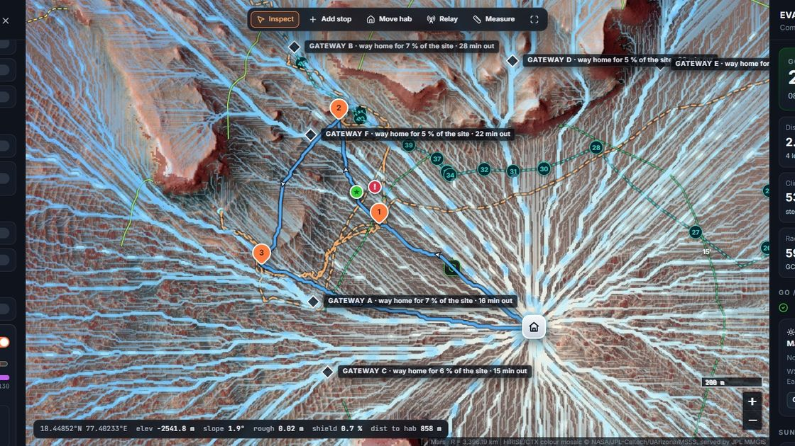<br><b>Ways home</b><br><sub>The fastest walk back from every point, as one network. Gateways are where many ways home merge.</sub></td>
<td width="33%" valign="top">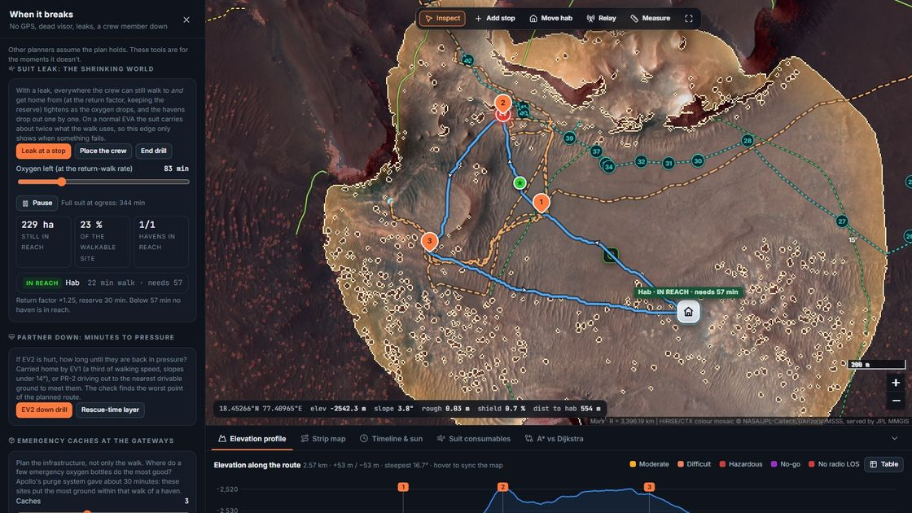<br><b>Shrinking world</b><br><sub>A suit leak: the ground the crew can still reach and get home from tightens as the oxygen runs down.</sub></td>
<td width="33%" valign="top">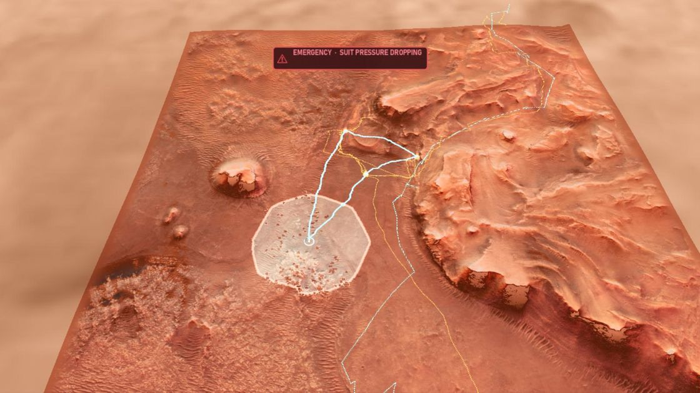<br><b>The leak drill in 3D</b><br><sub>In the console the ground with no way home dims behind a glowing edge that tightens as the minutes run.</sub></td>
</tr>
<tr>
<td width="33%" valign="top">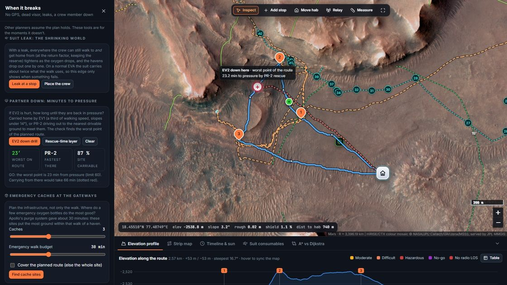<br><b>Partner down</b><br><sub>The worst point of the route for an injured partner, and the minutes to get them back to pressure.</sub></td>
<td width="33%" valign="top">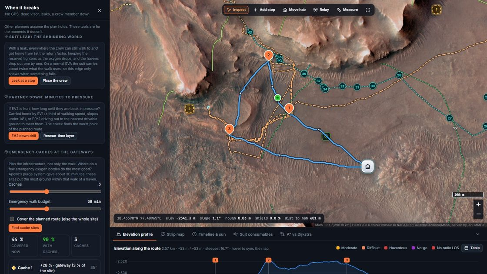<br><b>Emergency caches</b><br><sub>Where a few oxygen caches do the most good: here they raise the ground within 30 minutes of a haven from 44 % to 90 %.</sub></td>
<td width="33%" valign="top">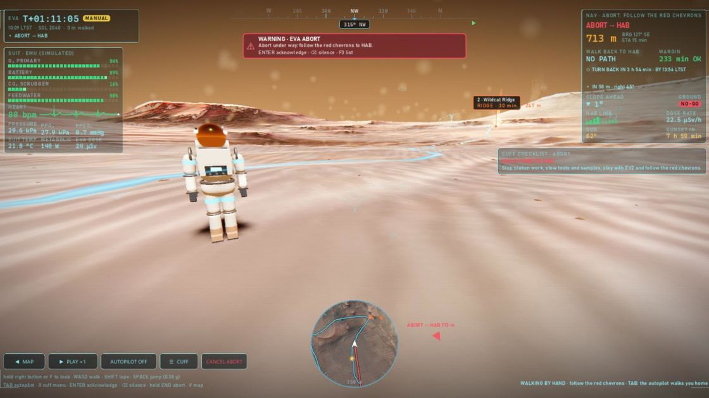<br><b>ABORT</b><br><sub>Hold End for a second: the crew turns for home on the fastest way back, along a red route to the airlock door.</sub></td>
</tr>
<tr>
<td width="33%" valign="top">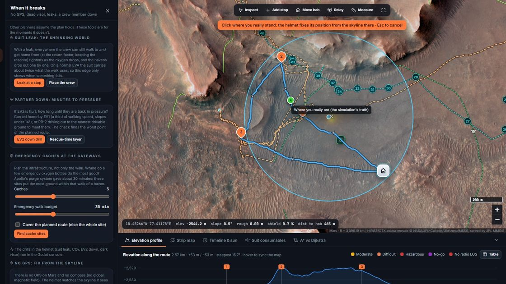<br><b>Skyline fix</b><br><sub>No GPS on Mars: the horizon the helmet sees is matched against the terrain model to fix the crew's position.</sub></td>
<td width="33%" valign="top">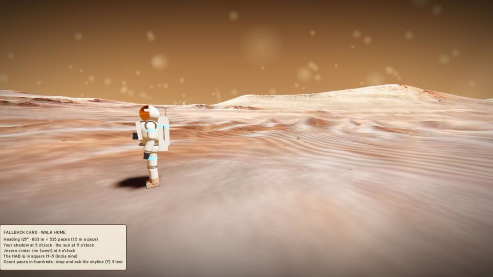<br><b>HUD-failure drill</b><br><sub>The visor goes dark. Only a paper card is left: heading, pace count, where your shadow falls, the habitat's grid square.</sub></td>
<td width="33%" valign="top">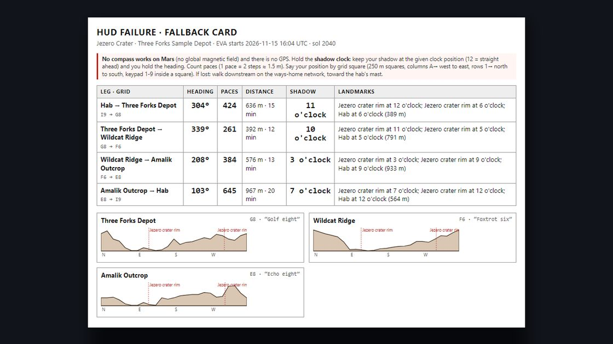<br><b>Fallback card</b><br><sub>Printed before the EVA: per leg the heading, paces, shadow clock and landmarks, and a skyline sketch per station.</sub></td>
</tr>
</table>

* **Ways home.** The fastest walk back from every point, drawn as one network that flows to the habitat like rivers.
  It shows the gateways where many ways home merge (six on Gale, 24-67 minutes out) and the ground with no way home.
  Click anywhere to trace your way back.
* **Shrinking world, a suit-leak drill.** The ground still in reach as oxygen runs down. With a leak at Ridge Alpha,
  120 minutes of oxygen leaves 194 ha in reach, and below about 52 minutes the habitat itself is out of reach. In the
  3D console's leak drill the crew is on 30 minutes of secondary oxygen: the ground they can no longer get home from
  dims red behind a glowing edge that tightens as the minutes run, and the visor says which havens are in reach.
* **Partner down.** The worst point of the route for an injured partner, and the time to get them to pressure: 21
  minutes at worst on the default Gale route, with PR-2.
* **Emergency caches.** Three oxygen caches at the gateways raise the share of the Gale site within 30 minutes of a
  safe haven from 17 % to 72 %. Placed caches become havens, and the ways-home network flows again into one basin
  per haven.
* **Skyline fix.** Where am I with no GPS? The helmet's view of the horizon is matched against the terrain model.
  The median error is 4 m on Gale and 17 m on Jezero's flat floor.
* **Fallback card and radio grid.** A printable card for a dead HUD, and grid references ("Kilo seven") to say where
  you are over the radio.
* **HUD-failure drill.** In the helmet the visor goes dark: no route, beacons or labels, only a paper card with the
  heading home, the pace count, where your shadow and the sun fall on a clock face, a named landmark on the skyline
  and the habitat's grid square. Ask the skyline for a fix if you are lost; at the door the walk is scored.
* **ABORT.** Hold End (or R3, the HUD button, or say "suit abort" and "suit confirm abort"): the autopilot walks the
  crew home at the walk-back pace along a red route that ends at the airlock door, or at PR-2's suitports.

### Plan smarter

<table>
<tr>
<td width="50%" valign="top">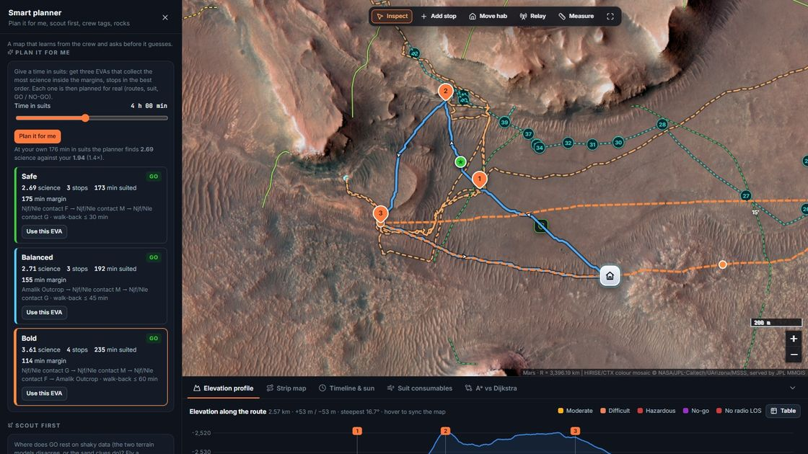<br><b>Plan it for me</b><br><sub>Give a time in suits and get three EVAs, safe, balanced and bold, each planned for real and each GO.</sub></td>
<td width="50%" valign="top">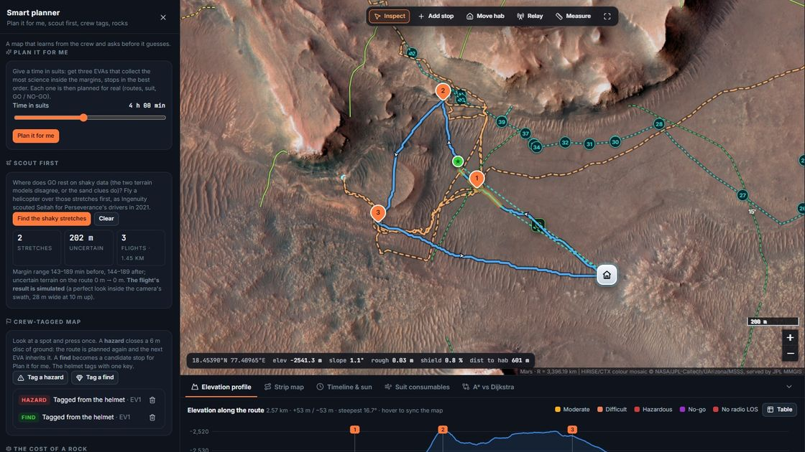<br><b>Scout first</b><br><sub>Where GO rests on uncertain data, a helicopter flight is planned over it, as Ingenuity scouted for Perseverance.</sub></td>
</tr>
<tr>
<td width="50%" valign="top">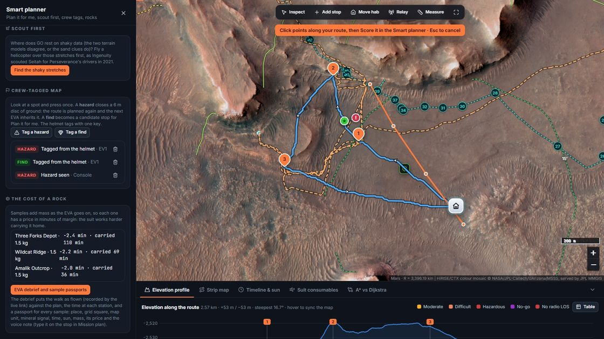<br><b>Crew tags, the cost of a rock, beat the planner</b><br><sub>Tag a hazard or a find, see what each sample costs in minutes of margin, and race your own sketched route (orange) against A*.</sub></td>
<td width="50%" valign="top">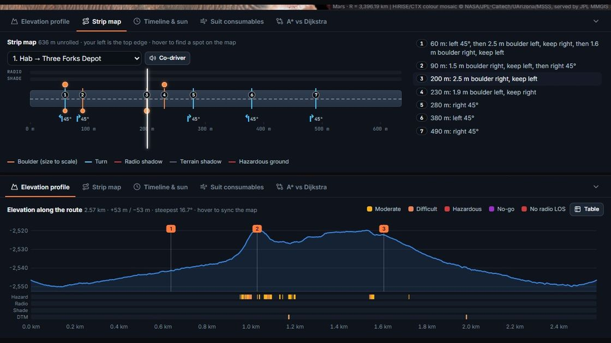<br><b>Strip map and pace notes</b><br><sub>Each leg unrolled as a straight strip with boulders, turns and shadows at their distances, read aloud by a co-driver voice.</sub></td>
</tr>
</table>

* **Plan it for me.** Give a time in suits and get three EVAs (safe, balanced, bold) that collect the most science
  inside the margins, with the stops in the best order, each planned for real. At the same 162 minutes in suits as
  the hand-picked Gale EVA it finds 1.3 times the science (1.4 times at Jezero), and all three come out GO.
* **Scout first.** It finds the stretches where GO rests on uncertain data (the two terrain models disagree, or the
  sand clues do), plans a helicopter flight over them, as Ingenuity scouted for Perseverance's drivers, and shows the
  plan again with the uncertainty narrowed. The flight's result is simulated, and the app says so.
* **Crew-tagged map.** Look at a spot and press once: a hazard tag closes that ground and the route is planned again;
  a find becomes a candidate stop.
* **The cost of a rock.** Samples add mass as the EVA goes on, so each one has a price in minutes of margin. The EVA
  ends with a debrief page: walked against planned, time at each station, and a passport for every sample.
* **Beat the planner.** Sketch your own route; it is scored with the same walking model and raced against A*.
* **Pace notes and a strip map.** Each leg unrolled as a straight strip with boulders (on their side, to scale),
  turns, climbs, radio shadow and terrain shadow at their distances, and a co-driver voice that reads the notes
  aloud ("350 m: 3.7 m boulder right, keep left, then left 45°").
* **Sun in your eyes.** Minutes walking into a low sun (glare in the visor) or with the sun straight behind (flat
  light that hides the relief), with the same loop walked the other way as an alternative.

### See the data together

<table>
<tr>
<td width="33%" valign="top">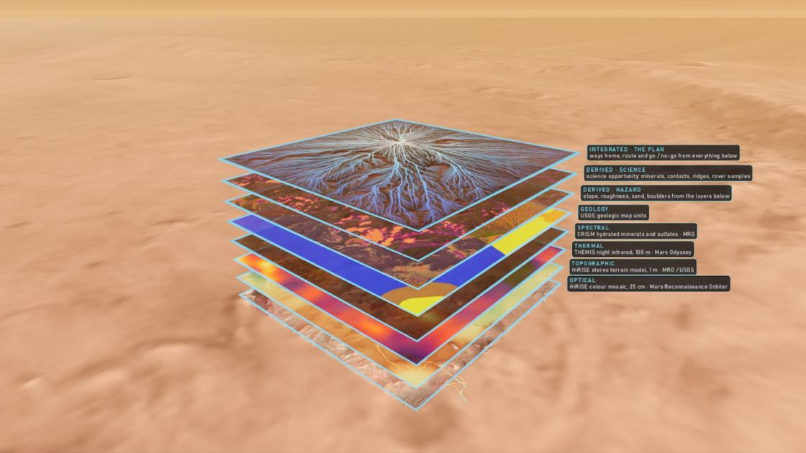<br><b>Layer tower, 3D console</b><br><sub>The data layers lift off the ground as a stack, each labelled with its mission and instrument.</sub></td>
<td width="33%" valign="top">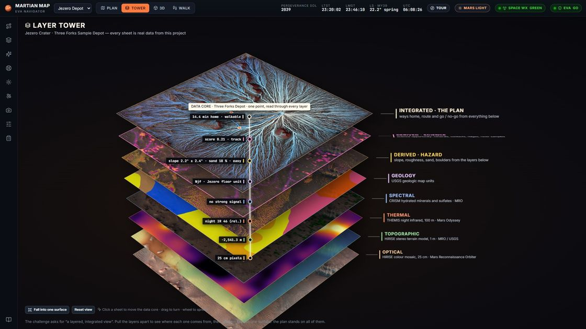<br><b>Layer tower, web planner</b><br><sub>A needle reads one point through every layer: optical, topographic, thermal, spectral, geology, hazard, science, the plan.</sub></td>
<td width="33%" valign="top">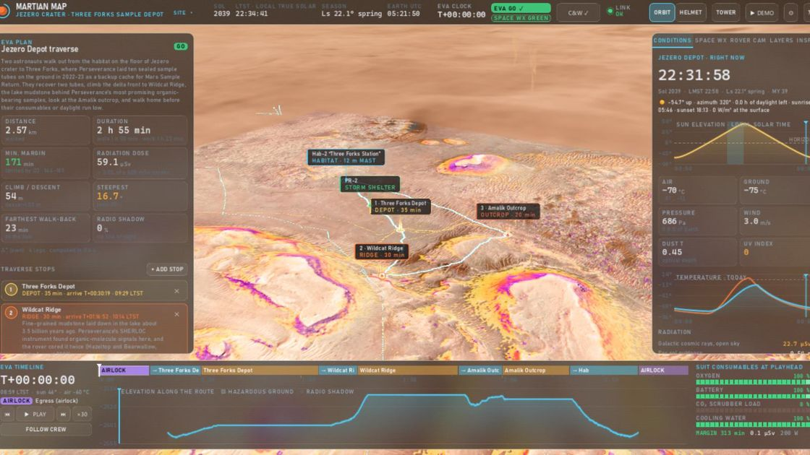<br><b>Any layer on the terrain</b><br><sub>The analysis layers drape on the 1 m terrain with a scan reveal. Here: the hazard classes.</sub></td>
</tr>
<tr>
<td width="33%" valign="top">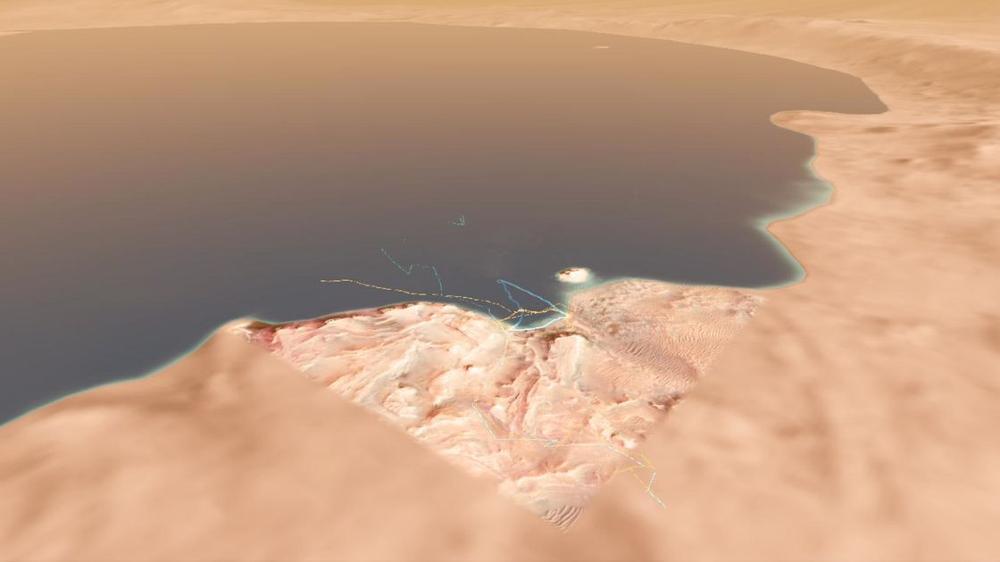<br><b>Flood the crater, 3D</b><br><sub>Jezero's ancient lake rises through the levels published by Mangold et al. (2024).</sub></td>
<td width="33%" valign="top">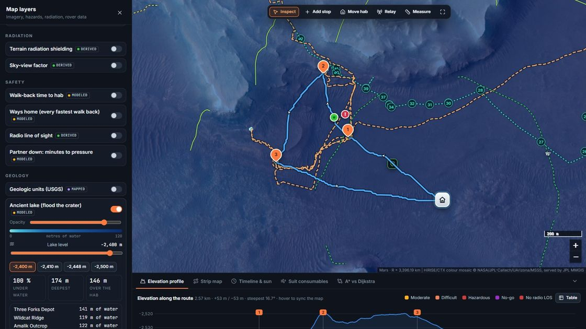<br><b>Flood the crater, web</b><br><sub>A level slider with the published levels, and the metres of water over the habitat and every stop.</sub></td>
<td width="33%" valign="top">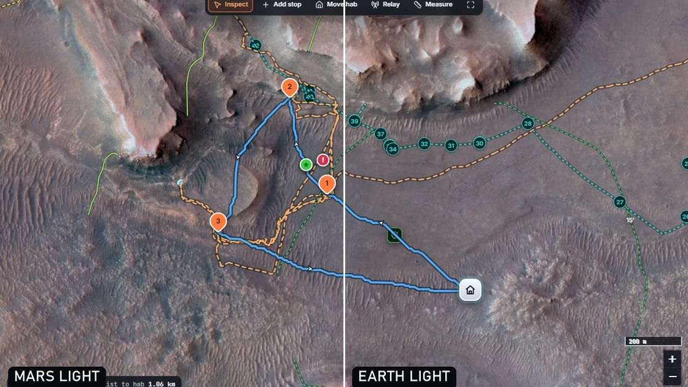<br><b>Geologist's white balance</b><br><sub>One switch shows the ground in Earth-like light, so rock colours read as they would at home.</sub></td>
</tr>
<tr>
<td width="33%" valign="top">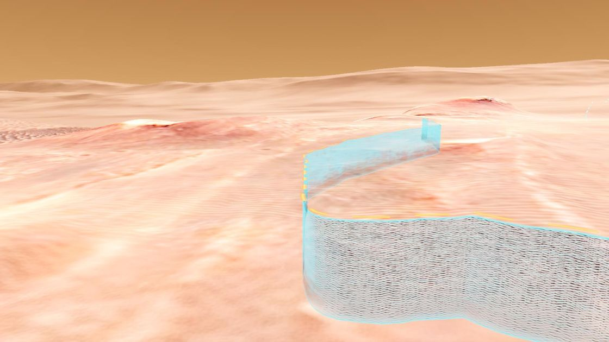<br><b>Ground radar, 3D</b><br><sub>Perseverance's RIMFAX radargrams hang under its track as a curtain you see through the ground.</sub></td>
<td width="33%" valign="top">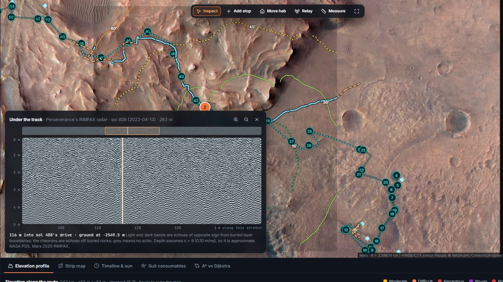<br><b>Ground radar, web</b><br><sub>Click a track to see 5 m down. Bands are buried layer boundaries; chevrons are echoes off buried rocks.</sub></td>
<td width="33%" valign="top">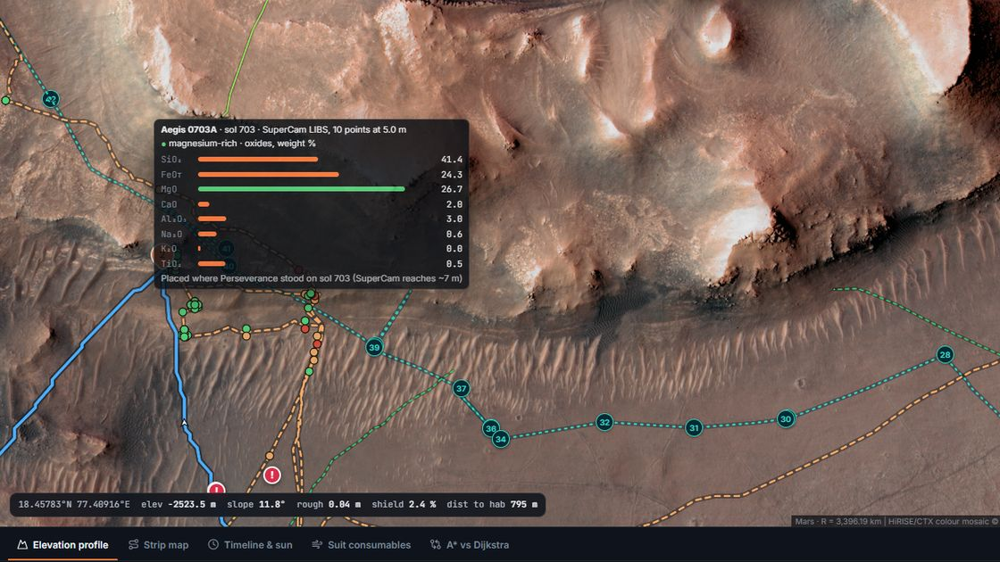<br><b>What the rocks are made of</b><br><sub>ChemCam and SuperCam laser chemistry at the rovers' targets, as pins with oxide bars.</sub></td>
</tr>
<tr>
<td width="33%" valign="top">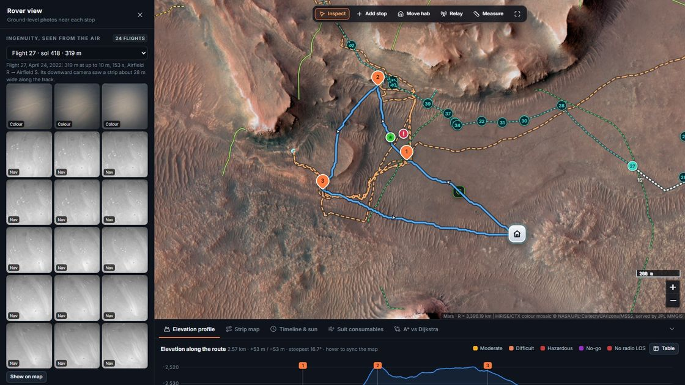<br><b>Ingenuity</b><br><sub>The helicopter's 24 flights over the site, the ground its camera saw, and its photos for each flight.</sub></td>
<td width="33%" valign="top">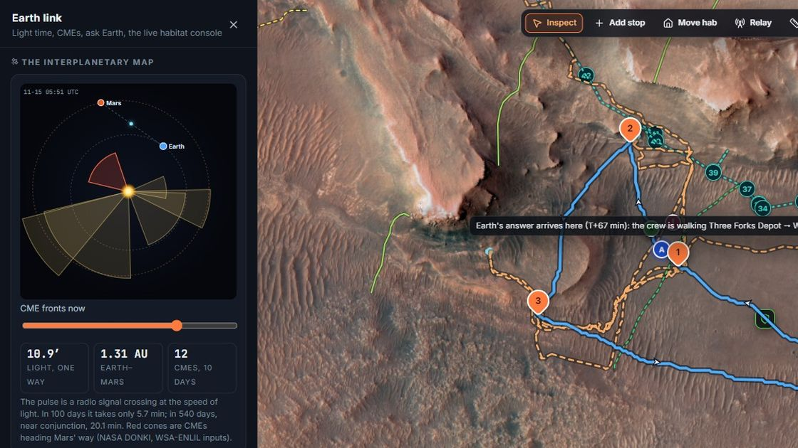<br><b>Earth link</b><br><sub>The planets today, CMEs on their way, the light-time delay, and where the crew will be when Earth's answer arrives.</sub></td>
<td width="33%" valign="top">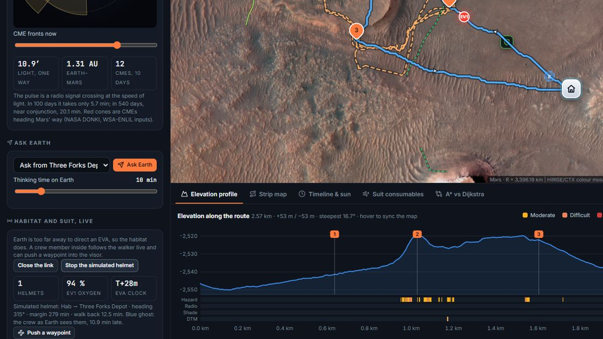<br><b>Habitat and suit, live</b><br><sub>The habitat follows EV1 live (red) and can push a waypoint into the visor. The blue ghost is the crew as Earth sees them, one light-time late.</sub></td>
</tr>
</table>

* **Layer tower.** The map's data layers lift off the ground as a 3D stack, each labelled with its mission and
  instrument, and a needle reads one point through every layer. In the 3D console it is the TOWER button and the
  opening shot of the demo.
* **Flood the crater.** Jezero's ancient lake at the levels published by Mangold et al. (2024). At −2,500 m, 57 % of
  the site is under water, 46 m over the habitat. In the 3D console the water rises through the published levels as
  one body of water (the low plains outside the crater rim stay dry), the lake bed shows through the shallows, and in
  the helmet the visor gives the metres of water overhead.
* **Habitat and suit, live.** The 3D console's helmet streams EV1's position, suit and alerts to the web planner's
  habitat console twice a second, and a crew member inside can push a waypoint or a message into the visor. Earth,
  11 light-minutes away today, sees the same walk one light-time late.
* **Earth link.** Sun, Earth and Mars where they are today, CMEs on their way, the light-time delay (11 minutes each
  way today) and an "Ask Earth" exchange that waits for the real delay.
* **Ingenuity at Jezero.** The helicopter's 24 flights over the site at their altitude, the ground its camera saw,
  and its photos for each flight.
* **The rover teams' own terrain models,** lined up with ours by phase correlation, so the rovers' tracks, samples
  and colour mosaics sit on the right ground. Rover heights now match our terrain within half a metre.
* **Geologist's white balance.** One switch shows the ground, the 3D view and the rover photos in Earth-like light,
  so rock colours read as they would at home (the rover teams publish both natural and white-balanced colour).
* **The sound of the site.** At Jezero, the wind as Perseverance's SuperCam microphone recorded it on sol 4. Curiosity
  carries no microphone, so at Gale the app says the wind has never been heard rather than inventing it.
* **What the rocks are made of.** The rovers' laser chemistry at their targets inside each site, from the NASA
  Planetary Data System: 462 ChemCam targets at Gale and 204 SuperCam targets at Jezero, as pins with oxide bars
  (SiO₂, FeO, MgO, CaO and more). Each pin sits where the rover stood that sol, and the point inspector shows the
  nearest targets, so a stop says what its rock is made of.
* **Under the rover's track.** Perseverance's RIMFAX ground-penetrating radar sounded the ground every 10 cm as it
  drove. 53 sols of its radargrams (7 km of track inside the Jezero site, from the NASA Planetary Data System) are laid
  along the drives: click a track in the web planner to see 5 m down, with the cursor following on the map, or press
  Shift+J in the 3D console to hang them under the track as a curtain you see through the ground. Light and dark bands
  are buried layer boundaries; the chevrons are echoes off buried rocks.

### Take it with you

<table>
<tr>
<td width="33%" valign="top">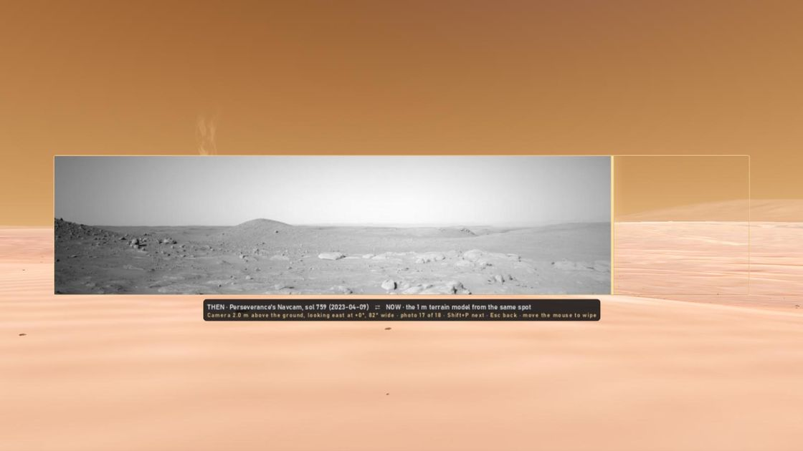<br><b>Then and now</b><br><sub>Stand exactly where the rover's camera stood and wipe between its photo and our terrain rendered from the same pose.</sub></td>
<td width="33%" valign="top">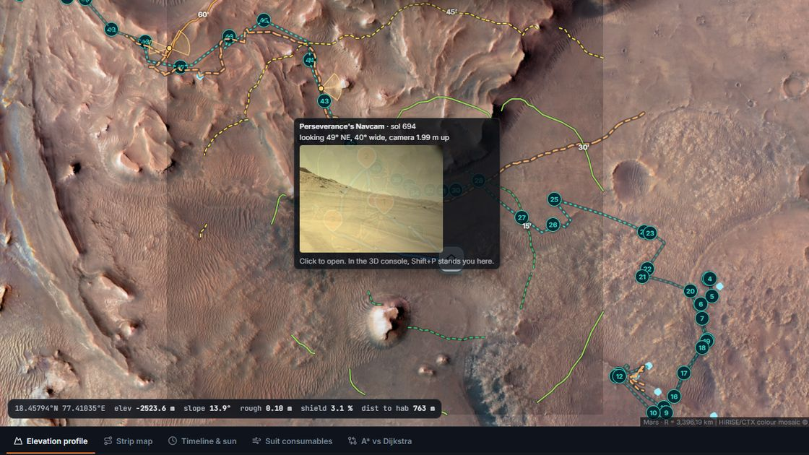<br><b>Photos where they were taken</b><br><sub>In the web planner the same photos are view cones on the map: hover for the photo, click to open it.</sub></td>
<td width="33%" valign="top">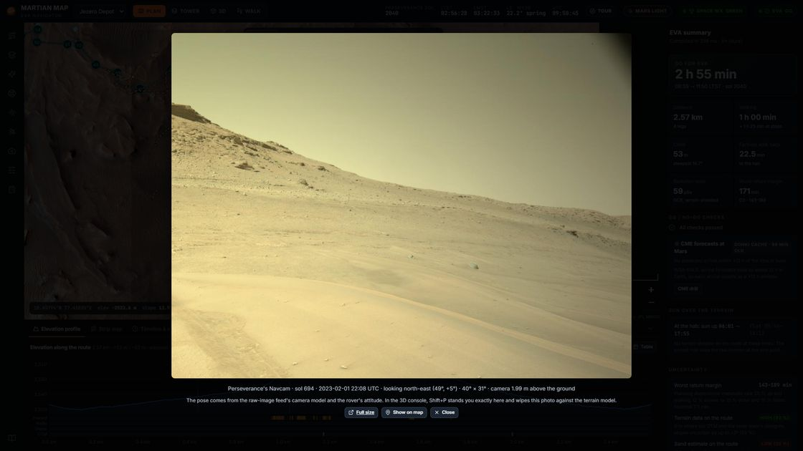<br><b>The rover's own view</b><br><sub>Each photo opens with its pose: the sol, where the camera looked and how high it stood.</sub></td>
</tr>
<tr>
<td width="33%" valign="top">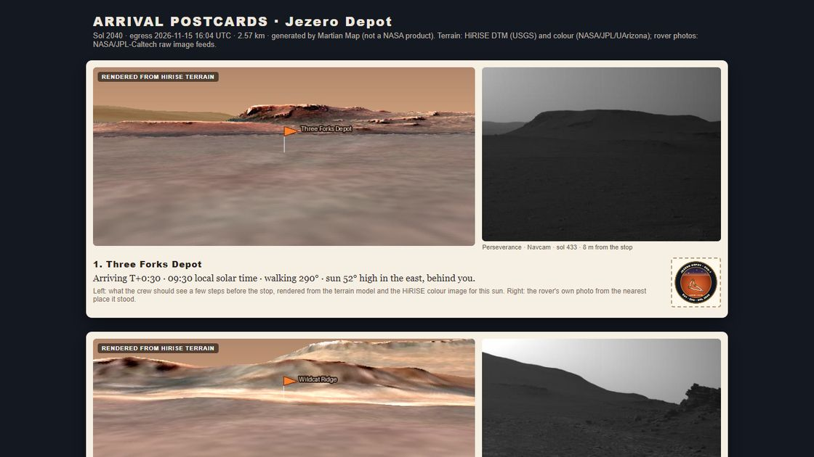<br><b>Arrival postcards</b><br><sub>For each stop, the view a few steps before arriving, rendered from the terrain, beside the rover's own photo.</sub></td>
<td width="33%" valign="top">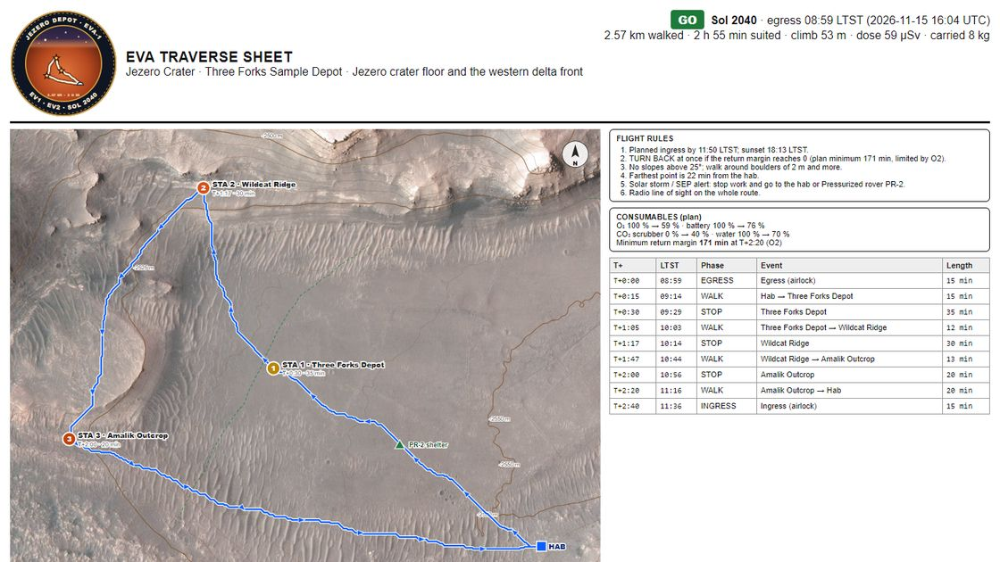<br><b>Traverse sheet</b><br><sub>An Apollo-style sheet to print: the photomap, stations, flight rules, consumables and the timeline.</sub></td>
<td width="33%" valign="top">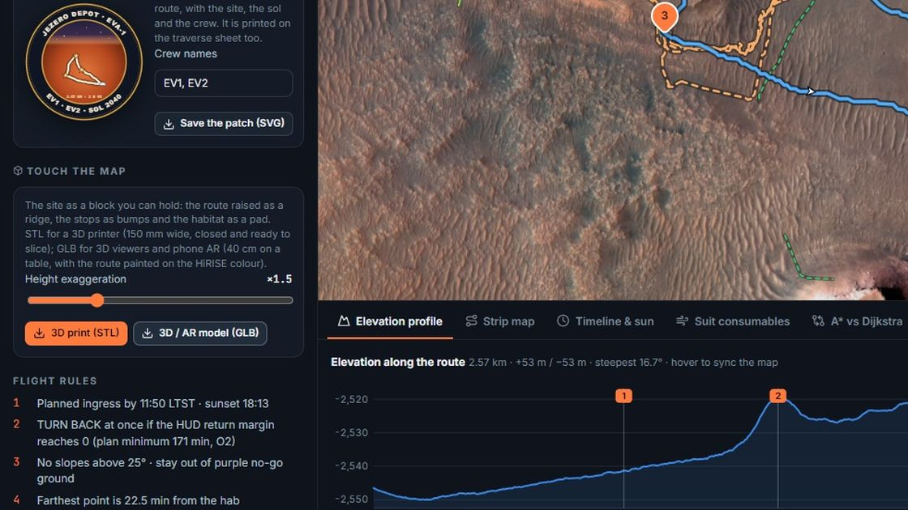<br><b>Mission patch, touch the map</b><br><sub>A patch drawn from the route's own shape, and the site as an STL to 3D-print or a GLB for phone AR.</sub></td>
</tr>
</table>

* **Then and now.** Press Shift+P in the 3D console to stand exactly where the rover's navigation camera stood,
  looking where it looked (from the camera model and rover attitude in NASA's raw-image feeds), and wipe between the
  rover's photo and our terrain model rendered from the same spot. It shows what the crew will see there, and how
  well the map matches the real ground. In the web planner the same photos are view cones on the map: hover for the
  photo, click to open it.
* **Arrival postcards.** For each stop, the view a few steps before arriving, rendered from the HiRISE terrain and
  colour for the arrival time and sun (with Mount Sharp on the horizon at Gale), beside the rover's own navigation-
  camera photo from the nearest place it stood.
* **Mission patch.** A patch for each EVA drawn from the route's own shape, with the site, the sol and the crew's
  names; it is printed on the traverse sheet and stamped on the postcards.
* **Traverse sheet and cuff checklist.** An Apollo-style photomap with stations, times, tasks and flight rules, and a
  cuff checklist for each station, both ready to print.
* **Touch the map.** The site as a 3D-printable block (closed STL, 150 mm) with the route raised as a ridge and the
  stops as bumps, and as a textured GLB for 3D viewers and phone AR.
* **Walk it on Earth.** On a phone, walk the EVA at full scale on a sports field: GPS moves your dot across the Mars
  site with the walk-back time live, and the route can be saved as a GPX laid over your own neighbourhood. Your
  position stays in the browser. `run_web.ps1 -Lan` serves the planner over HTTPS on your Wi-Fi, which phones
  require before they share GPS.

## Two clients, one plan

Both clients talk to the same FastAPI backend, so a plan made in one is the plan walked in the other.

<table>
<tr>
<td width="50%" valign="top">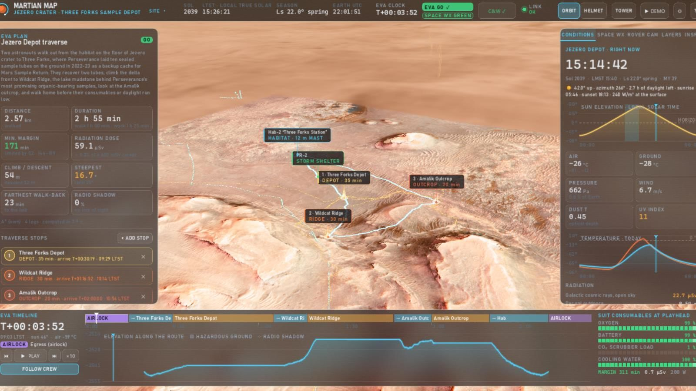<br><b>3D console · orbit view, for planning</b><br><sub>The site from the real 1 m terrain model, the plan panel, live Mars clocks, the data tabs and the EVA timeline.</sub></td>
<td width="50%" valign="top">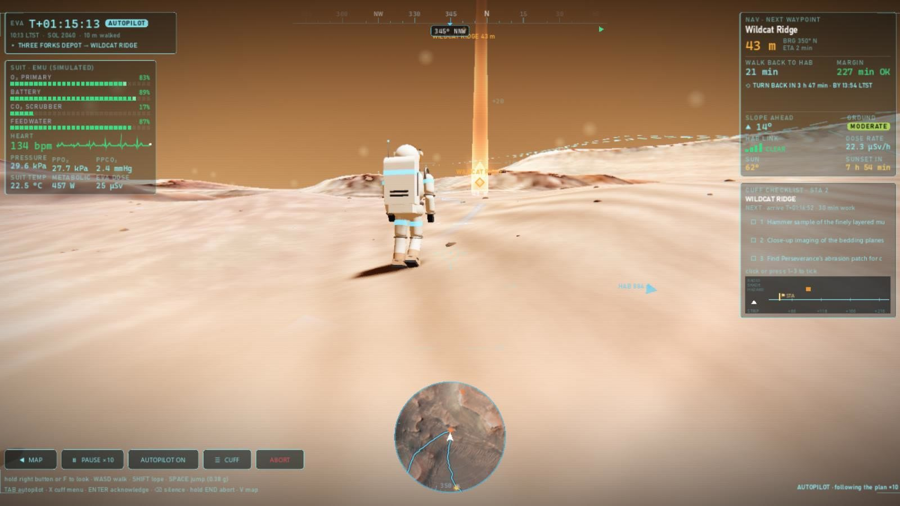<br><b>3D console · helmet HUD, for walking</b><br><sub>Compass, suit, next waypoint, walk-back and turn-back time, radio, cuff checklist and minimap, with EV2 beside you.</sub></td>
</tr>
</table>

* **Web planner** (React and Leaflet) for desktop, tablet and phone, in the habitat. Ten panels: mission plan, map
  layers, smart planner, when it breaks, conditions, Earth link, rover view, suit and limits, cuff checklist, and
  data and method. PLAN is the map and TOWER is the layer stack; the 3D and WALK tabs hand over to the 3D console. A
  one-minute guided tour starts on the first visit (TOUR in the top bar, or `?tour` in the address); on a phone the
  panels open as sheets over the map. The top bar keeps the Mars clocks (mission sol, local true and mean solar time,
  season) beside the space-weather and GO / NO-GO lights.
* **3D console** (Godot 4.7): orbit view for planning, first-person helmet HUD for walking, the moving rover, a
  hold-to-confirm ABORT that walks the crew home, glove mode and a cuff menu for suited hands, gamepad and offline
  voice commands, a guided tour and a hands-free demo. It runs at 25-30 FPS on an Intel UHD 620 laptop. More in
  [godot/README.md](godot/README.md).
* **Helmet tools** in the 3D console: a ghost astronaut that walks the plan at the planned pace (K), a data
  flashlight that shows a layer only where you look (O), synthetic vision with glowing contours and snow poles
  every 50 m for dust or flat light (N), Earth light (B), hazard and find tags where you look (T), co-driver pace
  notes read aloud, Geiger clicks from the dose rate and a detector tone over science ground, the HUD-failure drill
  (U), the skyline fix (Y), the ancient lake (I), the ground radar curtain (Shift+J) and then-and-now (Shift+P).

<table>
<tr>
<td width="33%" valign="top">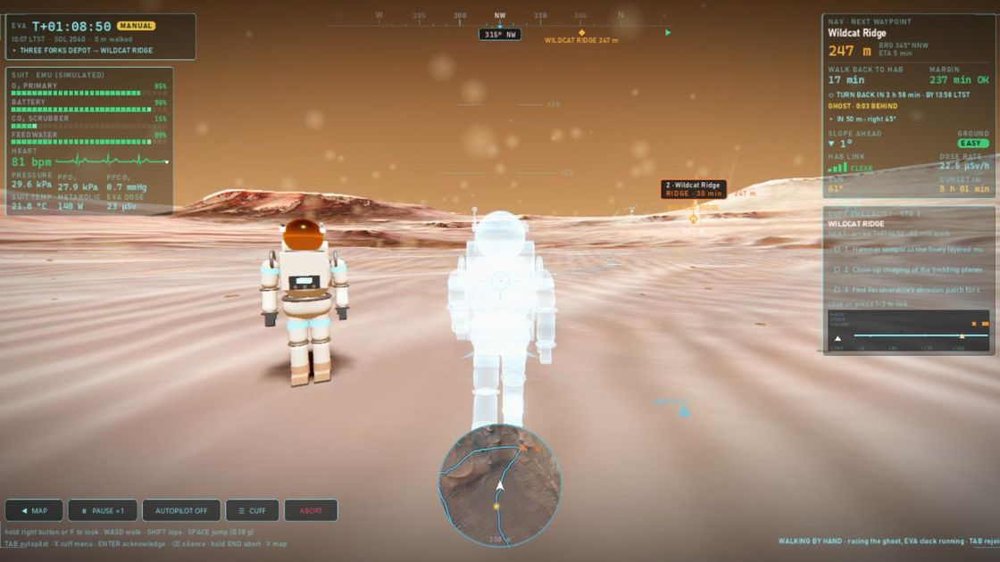<br><b>Ghost pacer</b> <kbd>K</kbd><br><sub>A hologram walks the plan at the planned pace: ahead of it you are early, behind it you are late.</sub></td>
<td width="33%" valign="top"><br><b>Data flashlight</b> <kbd>O</kbd><br><sub>A data layer shown only where you look, like a torch beam, so the rest of the world keeps its real colours.</sub></td>
<td width="33%" valign="top"><br><b>Synthetic vision</b> <kbd>N</kbd><br><sub>Glowing 1 m contours and snow poles every 50 m, for dust, dusk or flat light.</sub></td>
</tr>
<tr>
<td width="33%" valign="top"><br><b>Cuff menu</b> <kbd>X</kbd><br><sub>Every crew action on big buttons, for gloves, the d-pad or the number keys.</sub></td>
<td width="33%" valign="top"><br><b>Tags where you look</b> <kbd>T</kbd><br><sub>Tag a hazard or a find with one key. A hazard closes that ground and the route is planned again.</sub></td>
<td width="33%" valign="top"><br><b>Skyline fix</b> <kbd>Y</kbd><br><sub>Ask the skyline where you are: a grid square, the uncertainty, and the bearing and distance home.</sub></td>
</tr>
<tr>
<td width="33%" valign="top"><br><b>The habitat and the route</b><br><sub>The route flows out from the habitat. Play the EVA and ride along behind the crew as their suits drain.</sub></td>
<td width="33%" valign="top"><br><b>The PR-2 ride</b><br><sub>On a rover-assisted EVA the crew rides out in PR-2; the view becomes a chase camera behind the rover.</sub></td>
<td width="33%" valign="top"><br><b>Abort, from orbit</b><br><sub>In orbit view the crew figures walk the red route home, and FOLLOW CREW follows them.</sub></td>
</tr>
<tr>
<td width="33%" valign="top"><br><b>Ways home, in 3D</b><br><sub>The same network draped on the terrain, with pulses flowing toward the habitat.</sub></td>
<td width="33%" valign="top"><br><b>Earth light</b> <kbd>B</kbd><br><sub>The white balance in the helmet: the terrain and the sky as they would look under Earth's light.</sub></td>
<td width="33%" valign="top"><br><b>Guided tour</b><br><sub>On the first run a tour rings each part of the console in turn and explains it.</sub></td>
</tr>
</table>

<table>
<tr>
<td width="33%" valign="top"><br><b>Web guided tour</b><br><sub>Eleven stops in about a minute, a spotlight on each part of the planner. It starts by itself on a first visit.</sub></td>
<td width="33%" valign="top"><br><b>On a phone</b><br><sub>The panels open as sheets over the map. Walk it on Earth uses the phone's GPS.</sub></td>
<td width="33%" valign="top"><br><b>Every control on one screen</b><br><sub>F1 in the console. Every key and gamepad button can be rebound.</sub></td>
</tr>
</table>

## Built on NASA data

| Mission or source | Data | Used for |
|---|---|---|
| MRO HiRISE (NASA/JPL/University of Arizona, via USGS Astrogeology) | 1 m terrain models, 25 cm orthoimages, colour mosaics | Terrain, slope, roughness, boulders, routing, 3D scene |
| MRO CTX (JPL MMGIS) | Colour mosaics | Basemap |
| MRO CRISM (PDS Geosciences Node, ODE REST) | MTRDR mineral products | Mineral layers, science stops |
| Mars Odyssey THEMIS (ASU, USGS, NASA Mars Trek) | Night IR mosaics, day IR | Sand model, thermal layers |
| Curiosity | REMS weather, RAD dose rates, traverse, raw images; MSL Gale merged DEM mosaic (Parker & Calef, USGS) | Climate calibration, radiation, rover track, ground photos, terrain cross-check |
| Perseverance | MEDA weather, traverse, sample sites, raw images; Mars 2020 TRN HiRISE DTM mosaic (Fergason et al. 2020, USGS) | Sample-depot site, science stops, terrain cross-check |
| Ingenuity (JPL MMGIS, mars.nasa.gov) | Flight paths, waypoints, raw images | Flights layer, scouted ground, photos |
| USGS-NASA Planetary Geologic Mapping Program | SIM 3464 (Sun & Stack 2020), SIM 3292 (Tanaka et al. 2014) | Geologic unit layer and descriptions |
| NASA CCMC DONKI | CME analyses and predicted arrivals at Mars, flares, particle events | Space weather in the plan, Earth link |
| NASA GISS Mars24 | Mars time and sun position | Sol, local solar time, sun path |
| NASA Mars Trek | THEMIS day IR tiles, links for any inspected point | Thermal layer, cross-reference |
| ESA / DLR / FU Berlin (Space Agency Partner) | HRSC-MOLA blended terrain model, HRSC colour mosaic | Regional terrain and far horizon, context basemap |
| Curiosity ChemCam and Perseverance SuperCam (PDS Geosciences Node) | LIBS major-oxide compositions per target | Rover chemistry pins, point inspector |
| Mangold et al. (2024) | Jezero lake levels | Flood-the-crater layer |
| Perseverance SuperCam microphone (NASA/JPL-Caltech/LANL/CNES/CNRS/ISAE-Supaero) | Wind recording, sol 4 | The sound of Jezero |
| Perseverance RIMFAX (PDS Geosciences Node; Hamran et al. 2020) | Calibrated ground-penetrating radar radargrams, 53 sols | Radar curtain under the rover's track |

All of these are public products. The site pipeline downloads and caches them. All suit, walking and rover numbers
are planning assumptions and are shown in the app.

**The eight kinds of data the brief names, and where each one is in the app:**

| Kind of data | Source | In the app |
|---|---|---|
| Topographic | HiRISE stereo terrain models at 1 m, HRSC-MOLA at 200 m | Terrain, slope, roughness, horizon, routing, the 3D world |
| Optical | HiRISE 25 cm and CTX mosaics, rover and helicopter photos | Basemaps, boulder detection, then and now, postcards |
| Thermal | THEMIS night and day infrared | Sand model, thermal layers |
| Spectral | CRISM mineral composites: hydrated minerals and sulfates, clays, mafic minerals, iron minerals | Mineral layers, science score, suggested stops |
| Chemical | ChemCam and SuperCam laser chemistry | Rock chemistry pins, point inspector |
| Geophysical | RIMFAX ground-penetrating radar | Radargram viewer, radar curtain |
| Atmospheric | REMS and MEDA weather, the SuperCam microphone | Conditions, heater load, the sound of the site |
| Radiation and space weather | Curiosity RAD, NASA DONKI | Dose, terrain shielding, CME windows, storm drill |

## How we checked it

<table>
<tr>
<td width="50%" valign="top"><br><b>Checked against the rover's real drive</b><br><sub>99.8 % of Perseverance's 9.07 km inside the Jezero site is ground our map calls walkable.</sub></td>
<td width="50%" valign="top"><br><b>Data and method, in the app</b><br><sub>The sources, how each part works, and the limits to read before trusting it.</sub></td>
</tr>
</table>

* **Against the rovers' own drives.** A rover only drives where its team judged the ground safe, so its track is
  ground known to be crossable. Curiosity drove 4.9 km inside the Gale site and Perseverance 9.1 km inside the
  Jezero site; our walking map calls 97.8 % and 99.8 % of those tracks passable (99.8 % and 100 % within 2 m,
  allowing for position error), and no-go ground is 8 and 18 times rarer under the wheels than across each site.
  The web planner shows the check under Data & method, and it follows the walking limits you set.
* **CRISM lined up with HiRISE.** As the archive places them, CRISM's map-projected mineral products sit 140-310 m
  off the HiRISE terrain (136-222 m at Gale, 209-311 m at Jezero): their correlation with the HiRISE mosaic is about
  0. Each observation's true-colour image is now phase-correlated with the HiRISE mosaic at 16 m, and the shift is
  applied to its mineral layers (correlation 0.31-0.52 after), so the minerals and the science score built on them
  sit on the right ground. A shift is used only when it clearly improves the match.
* The sand model was tested against Jezero's mapped bedforms: AUC 0.84, and it flags 1 % of non-dune ground
  instead of 60 %.
* The rover teams' terrain models line up with ours within half a metre after the shift found by phase correlation
  (12 m and 5 m off before).
* The skyline fix is scored on 1,000 random points of each site.
* Planet positions match the January 2025 Mars close approach, and the Mars clocks are cross-checked against
  Mars24.
* The default plans for both sites are GO. A pytest suite of 203 tests covers routing, the suit model, the rover,
  boulders, CRISM, weather, Mars time, the emergency tools, the lake, the exports and the site configs. The 3D
  console has scripted check tours, including 25 NASA-standards checks and checks for every helmet tool, the lake,
  the layer tower, the live link, the radar curtain and then-and-now
  (`-- --tour=tools | lake | tower | live | radar | thennow`).
* Then and now is checked against the rovers' own headings: a frame's pointing from the camera model and attitude
  agrees with the waypoint's heading plus the mast's azimuth to within a degree or two.
* Each radar sol is kept only when its radargram's length matches the rover's drive that sol within 15 %.

## Limits

The app lists these itself, under Data & method. Read them before trusting it.

* A 1 m terrain model cannot see rocks under about 1-2 m. A real EVA needs rover or drone scouting.
* Weather is a climatology model, not a forecast.
* The sand likelihood is a model checked on one mapped dune field, not a measurement. The sand confidence layer shows
  where its clues disagree.
* Terrain confidence compares two stereo models. Both can be wrong in the same place.
* CME arrival forecasts miss by about 10 hours at Earth, and nobody scores them at Mars.
* The scout flight's result is simulated. The skyline fix is tested against the same terrain model it uses, so real
  panoramas will do worse. Gale's lake levels are a what-if; only Jezero's come from a paper.
* Suit, walking and rover numbers are planning assumptions from Apollo and analogue studies.

## Sites

<table>
<tr>
<td width="50%" valign="top"><br><b>Gale crater · Mount Sharp boxwork</b><br><sub>Curiosity's site: 1.92 km to a ridge and two hollows, GO.</sub></td>
<td width="50%" valign="top"><br><b>Jezero crater · Three Forks sample depot</b><br><sub>Perseverance's site: 2.57 km to the depot, Wildcat Ridge and Amalik, GO.</sub></td>
</tr>
</table>

| Site | Rover | Story |
|---|---|---|
| **Gale crater · Mount Sharp boxwork** (`gale_boxwork`) | Curiosity | Sample a mineral-cemented boxwork ridge and two sandy hollows that Curiosity explored in 2025 |
| **Jezero crater · Three Forks sample depot** (`jezero_threeforks`) | Perseverance | Recover two of the ten sample tubes Perseverance left at Three Forks, then visit Wildcat Ridge (organic-bearing lake mudstone) and the Amalik outcrop on the delta front |

| Default plan | Walking from the habitat | With the pressurized rover PR-2 |
|---|---|---|
| Gale | 1.92 km walked · 162 min in suits · farthest walk-back 17.8 min · GO | 0.88 km walked + 1.25 km driven · 127 min in suits · walk-back 6.8 min · GO |
| Jezero | 2.57 km walked · 175 min in suits · farthest walk-back 22.5 min · GO | 1.40 km walked + 1.38 km driven · 140 min in suits · walk-back 8.9 min · GO |

Each site is one JSON file in `config/sites/`, so a new site is a new file and one pipeline run.

## How it works


The helmet in the 3D console and the habitat console in the web planner also talk to each other through the server:
telemetry one way, waypoints and messages the other.

* **Terrain.** HiRISE stereo terrain models at 1 m are mosaicked per site; slope, shading, roughness and horizon
  angles are computed with our own numpy code, tested against known surfaces.
* **Routes.** Our A* in plain Python on a 2 m grid, with direction-aware Tobler walking speed, compared against
  scikit-image's Dijkstra.
* **Walk-back.** Dijkstra over reversed edges on a 4 m grid, so each value is the time to return, not to leave. Its
  predecessors, counted downstream, give the ways-home network and its gateways.
* **Radio.** Line-of-sight ray casting from the habitat mast and any relays, with Mars' curvature.
* **Horizon.** 24 directions from every 4 m cell, 1 m above the ground, out to 45 km, crater walls and mountains
  included. It gives the radiation shielding, and sunrise, sunset and shadows over the real terrain.
* **Suit.** Oxygen from metabolic work (about 0.26 g per watt-hour), battery with heaters (more in terrain shadow),
  CO₂ scrubber and cooling water. The margin is shown again with the metabolic rate and walking speed pushed both ways.
* **Space weather.** Each DONKI CME arrival forecast is a ±12 h window, compared with the time in suits.
* **Mars time.** Our implementation of NASA GISS Mars24, in Python, JavaScript and GDScript, cross-checked.

## Run it

You need Python 3.11, Node.js 18 or later (only to build the web planner, once), Godot 4.7 for the 3D console,
and ffmpeg only to record the demo as MP4. On Windows PowerShell, from this folder:

```powershell
python -m venv .venv; .venv\Scripts\pip install -r requirements.txt
.venv\Scripts\python -m pipeline.build_site gale_boxwork        # builds the site data: about 25 min the first time, cached after
.venv\Scripts\python -m pipeline.build_site jezero_threeforks
.\run_web.ps1                                                    # web planner: builds web/dist when needed, starts the API, opens http://localhost:8000
.\run_web.ps1 -Lan                                               # the same over HTTPS for phones on your Wi-Fi (port 8443, self-signed certificate)
.\run_godot.ps1                                                  # 3D console (finds Godot 4.7 via $env:GODOT or PATH)
.\run_godot.ps1 -Trailer -Site jezero_threeforks                 # record the hands-free demo to trailer\ (MP4 with ffmpeg)
.\run_godot.ps1 -Trailer -Short -Site jezero_threeforks          # the 30-second cut for a Space Apps demo video
.venv\Scripts\python -m pytest -q                                # tests
```

For development, run the API with `.venv\Scripts\python -m uvicorn server.main:app --port 8000` and the web planner
with `cd web; npm install; npm run dev` (http://localhost:5173). The built site data (`data/`) is not stored in the
repository; the pipeline downloads and builds it.

## Reference

Everything the app does, as lists you can search.

<details>
<summary><b>Every feature, and where it lives</b></summary>

<br>

**Web** is the web planner, **3D** is the 3D console, **Print** is a page or file you take away.

| Feature | What it does | Where |
|---|---|---|
| **Plan the walk** | | |
| Route planning | Directional A* written for this project on a 2 m cost grid, with an adjustable heuristic weight; scikit-image's Dijkstra as a cross-check | Web · 3D |
| Walking model | Tobler's hiking function scaled for a suited astronaut; flat speed, maximum and caution slope, maximum roughness, sand penalty, hazard aversion and carried load are sliders | Web |
| Hazard classes | Slope, metre-scale roughness, sand likelihood and boulders combine into easy, moderate, difficult, hazardous and no-go ground | Web · 3D |
| Sand model | Our own model from THEMIS night IR, HiRISE darkness and the USGS dune unit | Web · 3D |
| Boulder detector | Our own shadow detector on 25 cm HiRISE: about 4,400 boulders at Gale, 11,500 at Jezero | Web · 3D |
| Stops and habitat | Add, drag, reorder, rename and delete stops; time and tasks at each stop; move the habitat; a right-click menu on the map | Web · 3D |
| Suit simulation | Oxygen, battery, CO₂ scrubber, cooling water, suit pressure, ppO₂ and inspired CO₂, minute by minute | Web · 3D |
| Return margin | The suit must always hold the walk back, times a tired-return factor, plus a reserve; the worst margin and its limiting consumable are shown | Web · 3D |
| Science stop suggestions | Stops from CRISM minerals, geologic contacts, ridges and hollows, and rover sample sites, inside a walk-back limit, each with its reasons | Web · 3D |
| Rover-assisted EVA | PR-2 drives the crew to an automatic or hand-placed drop-off, with suitports; the parked rover is the safe haven and a radio relay | Web · 3D |
| EVA start time | The next sol at a chosen local true solar time; the plan checks daylight, heater load and sunset | Web · 3D |
| Sunlight over the terrain | Sunrise, sunset and shadow from the real horizon of every 4 m cell; a shadow layer that follows the EVA clock | Web · 3D |
| Radio coverage | Line of sight from the habitat mast and relays you place; dead zones on the map and along the route | Web · 3D |
| Walk-back time | The fastest walk back from every point, as a layer and as rings from 15 to 120 minutes | Web · 3D |
| Elevation profile | The route's profile with hazard, radio-shadow, shade and terrain-confidence bands | Web · 3D |
| Timeline and sun | The EVA's phases, sun elevation and air temperature over the timeline, with sunset over the real horizon | Web · 3D |
| Consumables chart | Each consumable over the EVA, and the return margin against the turn-back line | Web · 3D |
| A* against Dijkstra | Both algorithms on one leg, scored with the same walking model | Web |
| Point inspector | Everything known about a clicked point, from its grid square to the rock chemistry and the radar beneath it | Web · 3D |
| Map tools | Inspect, add stop, move habitat, place relay, measure, fit the site, copy coordinates, and a live cursor readout | Web |
| Mission file | Export, import and reset a mission; the 3D console adds undo and redo of every edit | Web · 3D |
| **Stay safe** | | |
| GO / NO-GO | A verdict with every reason: margin, CO₂, sunset, radio, terrain, space weather | Web · 3D |
| Caution and warning | NASA-STD-3001: four classes, NASA's tones, latched alerts, silence, shelve, inhibit, spoken warnings, a log saved as CSV, an alarm test, a master alarm | 3D |
| Turn-back time | "TURN BACK IN 38 min · BY 14:32 LTST", and TURN BACK NOW at zero margin | 3D |
| Uncertainty | The margin as a range under planning dispersions; terrain-confidence and sand-confidence layers | Web · 3D |
| Provenance tags | MEASURED, MAPPED, DERIVED, MODELED or RULE on every layer | Web |
| Space weather | DONKI CME arrivals at Mars as ±12 h windows, flares and particle events, and the first clear start | Web · 3D |
| CME what-if drill | A pretend full-hit CME 90 minutes into the EVA turns the plan NO-GO | Web · 3D |
| Solar-storm drill | A particle event adds its dose to the plan and raises the storm alarm in the helmet | Web · 3D |
| Radiation | Dose rate from Curiosity's RAD, the dose of this EVA, terrain shielding, sky view, shelters and terrain refuges | Web · 3D |
| Weather and sun | Sun now and through the sol, a REMS-calibrated climate model, the latest measured sols from REMS or MEDA | Web · 3D |
| Suit drills | Suit leak and CO₂ breakthrough, with the alarms they raise | 3D |
| Stale data and lost links | One STALE style for old feeds, a loss-of-signal timer in radio shadow, a caution when the server is down | 3D |
| **When something breaks** | | |
| Ways home | Every fastest walk back as one network, with gateways and the ground with no way home; click to trace your way back | Web · 3D |
| Shrinking world | The ground still in reach as oxygen runs down, and which havens are in reach | Web · 3D |
| Partner down | The worst point of the route for an injured partner, carried or met by PR-2, and a rescue-time layer | Web |
| Emergency caches | The cache sites that put the most ground within an emergency walk of a haven; placed caches become havens | Web |
| Skyline fix | A position from the horizon the helmet sees, with a 95 % circle, and a layer of how good a fix each place gives | Web · 3D |
| Fallback card | Per leg the heading, pace count, shadow clock, landmarks and grid squares; a skyline sketch per station | Print |
| Radio grid | 250 m squares, lettered and numbered as on Apollo traverse maps, to say a position over the radio | Web · Print |
| HUD-failure drill | The visor goes dark and you walk home with the card; the walk is scored at the door | 3D |
| ABORT | Hold to confirm: the crew walks home on a red route to the airlock door or PR-2's suitports | 3D |
| **Plan smarter** | | |
| Plan it for me | Three EVAs (safe, balanced, bold) with the most science inside the margins, each planned for real | Web |
| Scout first | The stretches where GO rests on uncertain data, and a helicopter flight over them | Web |
| Crew-tagged map | A hazard tag closes ground and the route is planned again; a find becomes a candidate stop | Web · 3D |
| The cost of a rock | Each sample's price in minutes of margin | Web |
| EVA debrief | Walked against planned, time at each station, and a passport for every sample | Print |
| Beat the planner | Your sketched route scored with the same model and raced against A* | Web |
| Pace notes and strip map | Each leg unrolled as a strip with its hazards; a co-driver voice reads the notes | Web · 3D |
| Sun in your eyes | Minutes of glare or flat light per leg, and the loop walked the other way | Web · 3D |
| **See the data together** | | |
| Layer tower | The data layers as a 3D stack with a needle through one point | Web · 3D |
| Flood the crater | The ancient lake at published levels, with the water depth over the habitat and each stop | Web · 3D |
| Habitat and suit, live | The helmet streams position, suit and alerts to the habitat console, which can push a waypoint or a message back | Web · 3D |
| Earth link | Sun, Earth and Mars today, CME cones, and the light-time delay | Web |
| Ask Earth | When an answer from Earth can arrive, and where the crew will be by then | Web |
| Ingenuity | The helicopter's flights, the ground its camera saw, and its photos | Web · 3D |
| Rover view | The rover's raw images from the place it stopped nearest to each stop, by camera | Web · 3D |
| Rover tracks and samples | The rover's traverse, its stops by sol, sample sites and place names, on our terrain | Web · 3D |
| Rock chemistry | ChemCam and SuperCam targets as pins with oxide bars | Web |
| Ground radar | RIMFAX radargrams as a viewer in the web planner and a curtain in the 3D console | Web · 3D |
| Mineral layers | Four CRISM composites lined up with HiRISE | Web · 3D |
| Thermal layers | THEMIS night and day infrared | Web · 3D |
| Geologic units | USGS map units with their names and interpretations | Web · 3D |
| Geologist's white balance | The ground and the photos in Earth-like light | Web · 3D |
| The sound of the site | Perseverance's wind recording at Jezero | Web · 3D |
| **Take it with you** | | |
| Then and now | The rover's photo wiped against our terrain from the same pose; view cones on the web map | Web · 3D |
| Arrival postcards | The rendered view at each stop beside the rover's own photo | Print |
| Mission patch | A patch drawn from the route, saved as SVG | Web · Print |
| Traverse sheet | An Apollo-style photomap with stations, times, tasks and flight rules | Print |
| Cuff checklist | Flight rules and a timeline with tasks; in the helmet, a checklist per station ticked with one key | Web · 3D · Print |
| Touch the map | The site as an STL to 3D-print and a GLB for 3D viewers and phone AR | Web · Print |
| Walk it on Earth | The EVA at full scale with phone GPS, a simulated walk, and a GPX over your own neighbourhood | Web |
| **The two clients** | | |
| Guided tours | A one-minute tour of the web planner and a first-run tour of the 3D console | Web · 3D |
| Phone and tablet layouts | Panels as sheets over the map on a phone; a slide-in summary on a tablet | Web |
| Orbit view | The site in 3D from the 1 m terrain model, with draped layers, labels, contours, a survey grid and a terrain scan | 3D |
| Helmet HUD | Compass tape, suit data, heart rate, next waypoint, walk-back, slope ahead, radio, dose rate, sun, minimap, alert strip, cuff checklist | 3D |
| Playback and demo | Play the EVA at several speeds with a chase camera; DEMO flies a whole EVA by itself | 3D |
| Helmet tools | Ghost pacer, data flashlight, synthetic vision and snow poles, Earth light, tags, Geiger clicks and a detector tone | 3D |
| Suited hands | Glove mode, a cuff menu, a gamepad, and offline voice commands | 3D |
| Settings | Seven tabs: graphics, display, HUD, alerts, controls, sound, data; a colour-blind-safe palette, text size, reduced flashing | 3D |
| The 3D world | A Mars sky with a blue sunset and Phobos, dust devils, the habitat, PR-2, the site rover, real boulders and two animated astronauts | 3D |
| Sound | Alarms, wind, suit fan and breathing synthesised in code | 3D |
| Frame-rate guard | Steps the graphics down by itself when a preset is too heavy for the GPU | 3D |
| Offline cache | Terrain and imagery cached on first launch; the console starts the backend itself when it is not running | 3D |
| Demo recorder | Records the hands-free demo as a video | 3D |

</details>

<details>
<summary><b>Every map layer, and where it comes from</b></summary>

<br>

**Base maps:** the HiRISE colour mosaic at 25 cm, a wider context mosaic (CTX at Gale, HRSC at Jezero), or none.

| Group | Layer | Tag | From |
|---|---|---|---|
| Terrain | Shaded relief (1 m) | DERIVED | HiRISE terrain model, our own hillshade |
| Terrain | Elevation tint | MEASURED | HiRISE terrain model |
| Hazards | Slope | DERIVED | HiRISE terrain model, 4 m baseline |
| Hazards | Roughness | DERIVED | Height left after fitting a plane to each 5 × 5 m patch |
| Hazards | Loose-sand likelihood | MODELED | THEMIS night IR, HiRISE colour, USGS geologic map; our own model |
| Hazards | Combined hazard class | RULE | The worst of slope, roughness and sand, by the limits you set |
| Hazards | Boulders | DERIVED | HiRISE orthoimage, our own shadow detector |
| Thermal | THEMIS night IR (100 m) | MEASURED | Mars Odyssey THEMIS controlled mosaic (ASU, USGS) |
| Thermal | THEMIS day IR (100 m) | MEASURED | Mars Odyssey THEMIS, served by NASA Mars Trek |
| Radiation | Terrain radiation shielding | DERIVED | The horizon of every 4 m cell |
| Radiation | Sky-view factor | DERIVED | The horizon of every 4 m cell |
| Safety | Walk-back time | MODELED | Direction-aware Dijkstra on a 4 m grid |
| Safety | Ways home | MODELED | Walk-back predecessors and flow accumulation |
| Safety | Radio line of sight | DERIVED | Ray casting from the mast and relays |
| Safety | Partner down: minutes to pressure | MODELED | Walking and rover models on the terrain |
| Geology | Geologic units | MAPPED | USGS SIM 3464 (Jezero), SIM 3292 (Gale) |
| Geology | Ancient lake | MAPPED at Jezero, MODELED at Gale | Mangold et al. 2024 at Jezero; a what-if at Gale |
| Science | Science opportunity | MODELED | CRISM, geologic contacts, ridges and hollows, rover sample sites |
| Science | Seen from the air by Ingenuity | DERIVED | Helicopter flight paths (Jezero) |
| Sun | Terrain shadow at the EVA time | DERIVED | Horizon and the Mars24 sun position |
| Navigation | Skyline fix quality | MODELED | Our skyline matcher |
| Confidence | Sand estimate confidence | MODELED | How far the sand clues agree |
| Confidence | Terrain data confidence | DERIVED | Our terrain model against the rover team's |
| Spectral | CRISM hydrated minerals and sulfates | MEASURED | MRO CRISM, lined up with HiRISE |
| Spectral | CRISM clays | MEASURED | MRO CRISM, lined up with HiRISE |
| Spectral | CRISM mafic minerals | MEASURED | MRO CRISM, lined up with HiRISE |
| Spectral | CRISM iron minerals | MEASURED | MRO CRISM, lined up with HiRISE |

**Vector layers:** the planned route, stops and habitat, walk-back rings, the rover's traverse, the rover's stops by
sol, 5 m contours, shelters, terrain radiation refuges, radio relays, place names, Ingenuity's flights, suggested
science stops, the radio grid, rover chemistry pins, the rover's photo view cones, and the ground radar tracks.

</details>

<details>
<summary><b>3D console controls</b></summary>

<br>

Press <kbd>F1</kbd> in the console for the full list. Every key and gamepad button can be rebound in the settings.

| Key | Action |
|---|---|
| <kbd>W</kbd> <kbd>A</kbd> <kbd>S</kbd> <kbd>D</kbd> | Walk in the helmet view, pan in orbit view |
| <kbd>Shift</kbd> · <kbd>Space</kbd> | Lope · jump, in 0.38 g |
| <kbd>Tab</kbd> | Autopilot on or off |
| <kbd>F</kbd> | Lock mouse-look |
| <kbd>V</kbd> | Orbit view or helmet view |
| <kbd>P</kbd> · <kbd>[</kbd> <kbd>]</kbd> | Play or pause the EVA · slower and faster |
| <kbd>Q</kbd> <kbd>E</kbd> · <kbd>R</kbd> <kbd>F</kbd> | Turn and tilt the map |
| <kbd>Enter</kbd> · <kbd>Shift</kbd>+<kbd>Enter</kbd> | Acknowledge the top alert · all alerts |
| <kbd>Backspace</kbd> | Silence the alarm tone |
| <kbd>F3</kbd> | Alert list, log and catalogue |
| Hold <kbd>End</kbd> | ABORT the EVA |
| <kbd>X</kbd> | Cuff menu |
| <kbd>1</kbd>-<kbd>5</kbd> | Tick the cuff checklist (info tabs in orbit view) |
| <kbd>K</kbd> | Ghost pacer |
| <kbd>O</kbd> | Data flashlight |
| <kbd>N</kbd> | Synthetic vision and snow poles |
| <kbd>B</kbd> | Earth light (white balance) |
| <kbd>T</kbd> · <kbd>Shift</kbd>+<kbd>T</kbd> | Tag a hazard · a find, where you look |
| <kbd>U</kbd> | HUD-failure drill |
| <kbd>Y</kbd> | Skyline fix |
| <kbd>I</kbd> | Flood the crater |
| <kbd>Shift</kbd>+<kbd>J</kbd> | Ground radar curtain |
| <kbd>Shift</kbd>+<kbd>P</kbd> | Then and now |
| <kbd>C</kbd> · <kbd>G</kbd> · <kbd>L</kbd> · <kbd>J</kbd> | Contours · survey grid · labels · terrain scan |
| <kbd>Ctrl</kbd>+<kbd>Z</kbd> · <kbd>Ctrl</kbd>+<kbd>Y</kbd> | Undo · redo a mission edit |
| <kbd>H</kbd> · <kbd>M</kbd> | Hide the interface · mute (alarms keep sounding) |
| <kbd>F1</kbd> · <kbd>F2</kbd> · <kbd>F11</kbd> | Help · settings · fullscreen |

**Gamepad:** left stick walks or pans, right stick looks or rotates, LB lope, A jump, RB autopilot, triggers zoom,
X play or pause, Y orbit or helmet, B back, d-pad left and right speed, d-pad up acknowledge, down silence, L3 cuff
menu, hold R3 abort, Start help.

**Voice** (off by default, offline): "suit status", "suit acknowledge", "suit silence", "suit next waypoint", "suit
turn back time", "suit autopilot on", "suit play", "suit helmet view", "suit check task", "suit alert list", "suit
cuff menu", and "suit abort" followed by "suit confirm abort".

</details>

<details>
<summary><b>The 28 conditions the console watches</b></summary>

<br>

| Group | Alerts |
|---|---|
| Suit | Suit pressure dropping (emergency) · suit pressure low · oxygen pressure low · CO₂ high in the helmet |
| Consumables | Oxygen supply low · battery low · feedwater low · CO₂ scrubber near capacity · consumables margin low · turn back now |
| Crew | Heart rate high · work rate high · EV2 separation |
| Environment | Radiation dose rate high · EVA dose above budget · sunset approaching · solar particle event · space weather alert |
| Comms | Radio shadow · mission server link lost · data stale |
| Navigation | Steep ground ahead · no-go terrain · off the planned route |
| Mission | EVA plan NO-GO · EVA abort · on station · mode change |

Each alert has a class (emergency, warning, caution or advisory), a tone, a spoken line for warnings and a line saying
what to do. The NASA-STD-3001 requirements behind them are listed in [docs/NASA_STANDARDS.md](docs/NASA_STANDARDS.md).

</details>

<details>
<summary><b>The API: 68 endpoints</b></summary>

<br>

One FastAPI backend serves both clients. Site paths start with `/api/sites/{site}`.

| Area | Endpoints |
|---|---|
| Sites and terrain | `GET /api/health` · `/api/sites` · `/api/sites/{site}` · `/files/{name}` · `/terrain` · `/regional-terrain` · `/dem.bin` · `/regional.bin` · `/boulders.bin` |
| Map layers | `GET /tiles/{layer}/{z}/{x}/{y}.png` · `/overlay/{layer}.png` · `/grid/{layer}.bin` · `/api/basemap/{mission}/{layer}/{z}/{x}/{y}.png` · `/tower` · `/tower/{layer}.jpg` |
| Planning | `POST /route` · `/plan` · `/suggest-stops` · `/autoplan` · `/scout` · `/score-route` · `/walkback` · `/viewshed` · `GET /query` · `/sun` |
| Conditions | `GET /conditions` · `/weather/live` · `/api/spaceweather` · `/api/orrery` · `/api/ask-earth` |
| Emergencies | `GET /ways-home` · `/ways-home/path` · `/envelope` · `POST /rescue` · `/caches` · `GET /skyline/profile` · `/skyline/check` · `POST /skyline/fix` · `GET /grid-ref` · `/grid-lines` |
| Science data | `GET /lake` · `/lake/mask.png` · `/chemistry` · `/radar` · `/radar/atlas.png` · `/radar/run/{run}.png` · `/then-now` · `/rover-check` · `/ingenuity` · `/api/ingenuity/images` · `/rover/nearest` · `/api/rover/{mission}/images` · `/api/image-proxy` |
| Crew tags | `GET`, `POST /tags` · `DELETE /tags/{id}` |
| Pages and files | `POST /traverse-sheet` · `/fallback-card` · `/fallback-card.json` · `/debrief` · `/postcards` · `/patch.svg` · `/export/{stl or glb}` |
| Live link | `WS /ws/live/{site}` · `GET /api/live/{site}` · `POST /api/live/{site}/telemetry` · `/api/live/{site}/command` · `GET /api/live/{site}/inbox` |

</details>

## Built with

| Part | Made with |
|---|---|
| Pipeline and backend | Python 3.11 · FastAPI · Uvicorn · Pydantic · NumPy · SciPy · scikit-image · Rasterio · Shapely · Pillow · Requests |
| Web planner | React 18 · Leaflet · Zustand · Vite · lucide-react icons · Inter and JetBrains Mono fonts |
| 3D console | Godot 4.7 · GDScript · 15 shaders (terrain, Mars sky, lake water, radar curtain, visor and more) |
| Tests | pytest (203 tests) · scripted check tours in the 3D console |
| Videos | Recorded from the app; ffmpeg; Blender for the renders in the 30-second demo |

About 45,000 lines of code: 13,000 of Python for the pipeline and backend, 7,000 of JavaScript and CSS for the web
planner, 22,000 of GDScript and shaders for the 3D console, and 3,000 of tests.

## Layout

```
config/sites/   site definitions (area, terrain models, basemaps, rover feeds, habitat, stops, shelters)
pipeline/       builds a site: terrain mosaic, slope and roughness, rover-team terrain and its offset, sky view and
                horizon, imagery, THEMIS, CRISM, geology, boulders, sand model, terrain confidence, rover track,
                Ingenuity, rover chemistry, ground radar, science score, contours
marsgeo/        shared library: Mars time, site grids, STAC search, map tiles, HTTP session
server/         FastAPI: plans, routes, walk-back, ways home, emergency tools, viewshed, conditions, weather,
                space weather, tiles, traverse sheet, live habitat link
web/            React + Leaflet planner (Vite)
godot/          Godot 4.7 3D EVA console (see godot/README.md)
tests/          pytest suite
docs/           NASA standards notes, the pictures in this README (docs/media), the full-tour video
```

## Status

Everything described above works and has been checked, in the web planner and in the 3D console.

## Team and credits

**Team Narayani Sena:** Manthan Singh Rauthan and Shivam Joshi, for the NASA Space Apps Challenge 2026, challenge
[*Interplanetary Survival Guide: Martian Map*](https://www.spaceappschallenge.org/2026/challenges/interplanetary-survival-guide-martian-map/).

Data: NASA/JPL-Caltech, the University of Arizona, MSSS, ASU, the USGS Astrogeology Science Center, the NASA Planetary
Data System, NASA CCMC and NASA GISS; HRSC terrain and colour from ESA, DLR and FU Berlin. The sources are listed
under [Built on NASA data](#built-on-nasa-data), and the app credits each one where it is shown.

## Disclaimer

An educational project made for the NASA Space Apps Challenge 2026. It is not an operational tool, and it is not a
NASA product or endorsed by NASA.

© 2026 Team Narayani Sena. All rights reserved.
