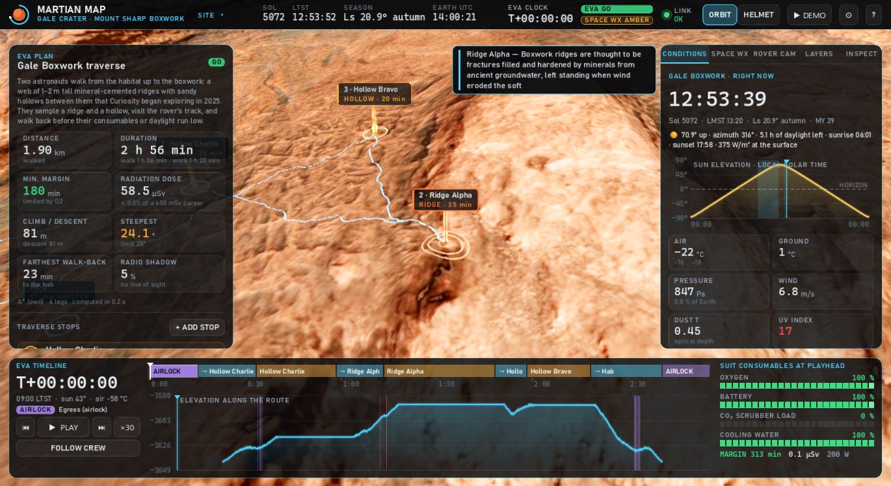
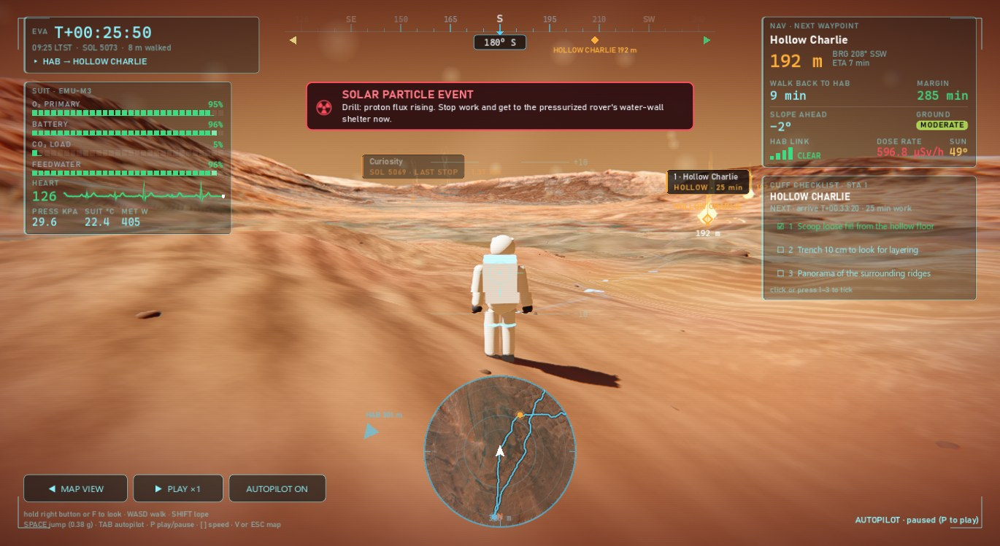
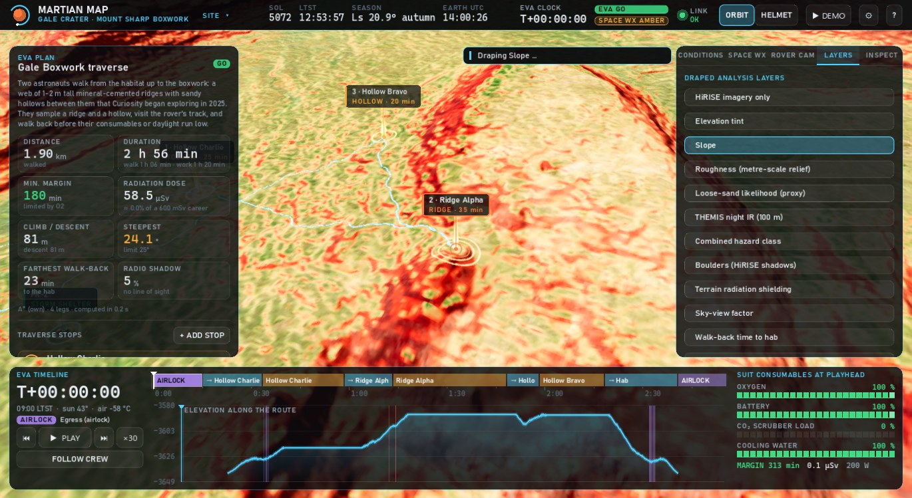
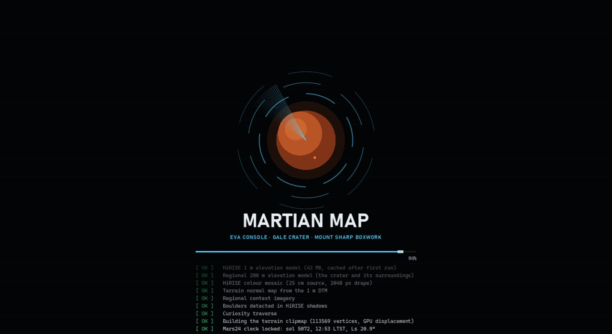

# Martian Map · EVA Console (Godot 4.7)

A native 3D interface for the Martian Map EVA planner. It draws the chosen site from the real 1 m
HiRISE terrain model and lets you plan the walk in orbit view. The sites are Gale crater's boxwork
(Curiosity) and Jezero's Three Forks sample depot (Perseverance). You can then walk the plan yourself
behind a helmet HUD, or ride out in the pressurized rover first. All data comes from the FastAPI
backend in `../server`.

Two views: **orbit** for planning and **helmet** for walking, with an animated boot, alerts and
transitions between them.

| Orbit view: planning | Helmet view: storm-drill alert |
|---|---|
|  |  |
| **Draped slope layer** | **Boot sequence** |
|  |  |

## Run it

```powershell
.\run_godot.ps1                # from martian-map/
.\run_godot.ps1 -Quality high  # force a preset (low | medium | high)
.\run_godot.ps1 -Editor        # open in the Godot editor
```

The app checks `http://127.0.0.1:8000/api/health` at start-up. If nothing answers, it starts
`uvicorn server.main:app` from `../.venv` itself, and stops it again when you quit. Point it
somewhere else with `-- --api=http://host:port` or the `MARTIAN_MAP_API` variable.

The first launch downloads the 42 MB 1 m elevation model, the imagery and the normal map into
`user://cache` (`%APPDATA%\Godot\app_userdata\Martian Map · EVA Console\cache`). Later launches
load them from there, and keep working when the API is offline.

## What is on screen

| Area | Contents |
|---|---|
| Boot | Typed boot log of each data load, a radar animation and the plan's GO / NO-GO verdict, then a wipe into a 7 s descent from 95 km onto the site (or onto the view you left last time) |
| Top bar | **SITE ▾** menu (asks, then switches site and remembers it), live Mars24 clock (sol, LTST, LMST, Ls and season, Earth UTC), EVA clock, GO / NO-GO badge (counts the seconds while a plan computes), space-weather badge, the **master alarm** (the worst unacknowledged alert and how many; click for the list), server link light (how long it has been down), view switch, **▶ DEMO**, **⚙** settings and **?** help |
| First run | A guided tour rings each part of the console in turn (stops, 3D view, data tabs, timeline, helmet switch, settings) and explains it. It runs once; **SHOW ME AROUND** in the settings or help plays it again |
| Demo | **▶ DEMO** flies through a whole EVA by itself: orbit overview, a chase camera behind the crew at ×30, the first station, the helmet view on autopilot, and back out. Any key, click, drag or stick hands the controls straight back |
| Settings (F2) | Seven tabs. **Graphics**: quality preset, 3D render scale, frosted glass, frame-rate cap, v-sync, FPS readout, visor effects, helmet field of view. **Display**: interface size, smallest text (16 px = NASA's 12 pt), colour-blind-safe palette, reduce flashing, pressure units. **HUD**: declutter (full / essential / minimal), brightness, colour. **Alerts**: alarm volume (never below 30 %), spoken alerts, advisory tones, TEST ALARMS. **Controls**: look and stick feel, invert, zoom and pan speed, hold-or-toggle lope and mouse-look, glove mode, voice commands with a self-test, and rebinding of every key and gamepad button. **Sound**, and **Data** (export and import a mission file). Changes apply at once and are saved in `user://settings.cfg`, along with the window size, fullscreen and each site's last camera view; DEFAULTS asks first |
| Caution & warning | NASA-STD-3001 alerts: emergency (flashing red), warning (red), caution (yellow) and advisory (blue), each with its Table 10.3-1 tone on its own audio bus (the first burst 10 dB quieter) and, for warnings, a spoken message. An alert stays on the banner and keeps sounding until acknowledged (Enter); Backspace silences the tone only. **F3** lists the active alerts (ACK, SHELVE 10 MIN), the log (SAVE LOG writes a CSV) and the catalogue of all 28 alerts with what each watches; untick IN SERVICE to inhibit one (reported every 5 min) |
| Plan panel | Count-up tiles (distance, duration, consumables margin with its range under planning dispersions, dose, climb, steepest slope, walk-back, radio shadow), stop cards with arrival times, science tasks, ticked-task counts and (selected) the light at the stop, why it is interesting and whether Ingenuity saw it, **✦ SUGGEST STOPS** (science stops inside a walk-back limit you can change; cards with + ADD), go/no-go checks with the DONKI CME check (**USE SOL …** moves the start clear of a predicted arrival) and the sun over the real terrain, start time, carried equipment (kg), A* vs Dijkstra, storm drill, **Drive out in PR-2** with PLACE / AUTO drop-off, and **SHEET**, an Apollo-style traverse sheet that opens in the browser |
| Info panel | **Conditions**: sun and temperature curves for the sol, weather, radiation. **Space WX**: NASA DONKI CME arrivals at Mars, flares, SEPs, the solar-storm drill and the suit drills (leak, CO₂ breakthrough). **Rover cam**: the site rover's raw images from the drive stop nearest a stop, or Ingenuity's photos from a flight. **Layers**: the analysis layers (slope, roughness, sand, hazard, boulders, shielding, sky view, walk-back, radio, THEMIS night IR, THEMIS day IR from NASA Mars Trek, USGS geologic units, four CRISM mineral composites, science opportunity, terrain shadow (it follows the EVA clock), sand and terrain confidence, ground seen by Ingenuity) draped on the terrain with a radial scan reveal, each with a ramp or a labelled class legend. **Inspect**: everything known about a clicked point, including its USGS map unit, how sure the sand estimate and the terrain are there, why it is interesting, sunrise and sunset over the terrain, the Ingenuity flight that saw it (with a button for its photos) and a link to NASA Mars Trek |
| Timeline dock | Colour-coded EVA timeline you can scrub (with predicted CME arrival windows hatched over it, a blue bar where the crew walks in terrain shadow, and sunset over the real horizon), elevation profile with hazard (red) and radio-shadow (violet) bands, suit consumables at the playhead, play / speed / follow-crew |
| 3D world | GPU-displaced terrain clipmap (1 m HiRISE inside the site, 200 m regional model out to the crater rim), Mars sky with a blue sunset and Phobos, sun from Mars24, dust motes and dust devils, the habitat (a ribbed main dome with portholes and a glass cupola, a regolith berm and a wall of regolith-filled bags for shielding, the airlock tunnel with its hatch, landing, ramp and rails, the science module on a bellows tunnel, the solar field, radio mast, tanks, radiators, a weather station, crates and a charging post), the pressurized rover PR-2 (it drives the crew out and back on a rover-assisted EVA), the site rover, real boulders from the HiRISE shadow detector, beacons (pink ones for suggested stops: click the label to add it), Ingenuity's flights at their altitude over Jezero, a flowing route and two animated astronauts that follow the timeline (suits with bearings at the waist, shoulders, elbows, wrists, knees and ankles, a hard upper torso with the chest display and control module, the life-support backpack, a gold visor with helmet lamps, gloves, dusty boots, a cuff checklist, and ID stripes in each crew member's colour; knees and elbows bend as they walk). Models are built from primitives and merged into one mesh per material, so the habitat costs 24 draw calls. The colour drape is shifted onto our DTM by the measured rover-team offset, so it lines up with the relief |
| Helmet HUD | Compass tape with waypoints; the mode (AUTOPILOT, MANUAL, RIDING, DEMO); suit consumables, heart rate and ECG, **suit pressure, ppO₂ and ppCO₂**, suit temperature, metabolic rate and EVA dose; next waypoint with distance and ETA; walk-back time, margin and the **turn-back time** ("TURN BACK IN 38 min · BY 14:32 LTST"); slope ahead; terrain class; radio bars with a loss-of-signal timer; dose rate; sun and time to sunset; heading-up minimap; projected waypoint markers; pitch ladder; the **alert strip** under the compass; and an Apollo-style **cuff checklist** for the current station (tick tasks with a click or the 1–5 keys). Every out-of-limit value carries a word (LOW, HIGH, STEEP …) as well as a colour. Buttons: MAP, PLAY, AUTOPILOT, CUFF menu, and ABORT (hold). While the crew rides in PR-2, the view becomes a chase camera behind the rover. The visor shader adds lens curvature, breath fog, glitches and the red storm alarm |

Sounds (UI blips, alarms, wind, suit fan, breathing) are synthesised in code; no audio files are shipped.
The first run builds them on a worker thread while the boot screen plays and caches them in
`user://cache/sfx_v3`. Interface sounds and ambience have their own buses (and volume sliders), the
loops cross-fade at their seams, and when all ten voices are busy an alert replaces the least
important sound instead of being cut off.

## Controls

Press **F1** in the app for the full list. The main ones:

* **Orbit view:** left-drag rotates. Right- or middle-drag pans, keeping the ground you grabbed under
  the cursor, and glides on if you let go while moving. The wheel zooms toward the cursor. Click a
  stop or any label to select it or fly there, and drag a stop (or its label) to move it; the EVA is
  planned again. **Ctrl+Z / Ctrl+Y** undo and redo every mission edit.
* **Helmet view:** **WASD**, **Shift** and **Space** walk, lope and jump in 0.38 g, with the speed
  ramping up and down and boulders to walk round. Hold the right button to look around, or press
  **F** to lock mouse-look. **Tab** toggles the autopilot. The habitat (both modules), its solar field,
  PR-2 and Curiosity are solid: by hand you slide along their walls, and the autopilot and EV2 walk
  round them the short way. Plan routes start and end at the habitat's centre point, so the crew
  starts and ends a walk in front of the airlock door instead (on a rover-assisted EVA, at PR-2's
  suitports), with EV2 beside them.
* **Caution & warning:** **Enter** acknowledges the top alert (**Shift+Enter** all of them), **Backspace**
  silences the tone, **F3** opens the alert list, log and catalogue. **Hold End** for a second to ABORT the
  EVA: the clock runs and the autopilot walks the crew home along a red route to the haven at the
  walk-back pace, EV2 leading the way (**Tab** takes over by hand, and picks the red route up again
  where it passes closest; switching to the helmet view mid-abort carries on at real time). The red
  route goes round the habitat, its solar field and the rovers to the haven's way in, so they stop in
  front of the airlock door (or at PR-2's suitports), the abort warning is acknowledged and the HUD
  says ABORT COMPLETE; hold again to cancel and go back to the plan. If the EVA clock reaches the plan's end
  mid-abort it holds there until they are home. **X** opens the cuff menu: every crew action on big
  buttons, for gloves, the d-pad or the number keys.
* **Anywhere:** **V** switches view, **Space / P** plays the EVA and **[ ]** change its speed. The keys
  **1–5** tick the cuff checklist (in orbit view they switch the info tabs). **H** hides the interface,
  **M** mutes the interface and ambience (alarms keep sounding), **F2** opens the settings, **F11** goes fullscreen.
* **Gamepad:** left stick walks (how far you push sets the pace) or pans the map, right stick looks
  or rotates, **LB** lope, **A** jump, **RB** autopilot, triggers zoom, **X** play/pause,
  **Y** orbit ⇄ helmet, **B** back, d-pad ◀ ▶ speed, d-pad ▲ acknowledge, ▼ silence, **L3** cuff menu,
  **hold R3** abort, **Start** help, **Back** hides the interface.
* **Voice** (Settings → Controls, off by default): Windows' own offline recogniser listens for "suit status",
  "suit acknowledge", "suit silence", "suit next waypoint", "suit turn back time", "suit autopilot on/off",
  "suit play/pause", "suit helmet/map view", "suit check task", "suit alert list", "suit cuff menu", and
  "suit abort" followed by "suit confirm abort". Answers are spoken with Windows' voice.

Movement keys are bound by their position on the keyboard, so WASD works on AZERTY and other layouts.
Every key and gamepad button can be rebound in Settings → Controls (a clash with another action is
shown, not blocked).

## How it works

```
scripts/app/    main.gd (shell: boot, input routing, alerts, test tours)   director.gd (demo mode)
scripts/core/   api.gd (HTTP + cache, starts the backend)   mission.gd (state, plan, timeline, undo, drills, mission files)
                mars_time.gd (Mars24, the third copy next to Python and JS)   geo.gd   terrain_data.gd
                quality.gd (presets per GPU)   sfx.gd (procedural audio, NASA alarm tones)   controls.gd (actions, rebinding)
                settings.gd (user settings, bindings, remembered state)   cw.gd (caution & warning)
                cw_monitor.gd (the alarm limits)   telemetry.gd (EV1's state)   suit_model.gd (pressure, ppO2, ppCO2)
                voice.gd (offline voice commands)
scripts/world/  world.gd   terrain_clipmap.gd   orbit_rig.gd   walker.gd   rock_field.gd   ribbon.gd   models.gd
scripts/ui/     ui_kit.gd (theme, palettes, glass, tweens, confirm)   top_bar / plan_panel / info_panel / bottom_dock / helmet_hud
                settings_panel.gd   cw_panel.gd   cuff_menu.gd   coach.gd (guided tour)   callouts.gd   alerts.gd
                boot_screen.gd   lightbox.gd
                widgets/ (charts, gauges, compass, minimap, ECG)
shaders/        terrain   mars_sky   ribbon   beacon   hologram   chevron   dust_devil   glass   glass_lite   visor
```

* **Terrain:** a single 337×337 to 513×513 grid with 1 m spacing near the camera. The spacing grows
  geometrically to 64 km, and the grid re-centres under the camera. The vertex shader reads the
  DTM (R32F texture, 3248×3264) and blends into the regional model outside the site. Lighting
  uses the pipeline's 0.8 m normal map, so ridges stay sharp where the mesh is coarse. The CPU
  keeps the same arrays for walking, picking and the HUD, so what you stand on is what is drawn.
  Both height models carry mipmaps: a coarse vertex reads the level that matches its spacing (one
  trilinear fetch), so far ridges don't shimmer as the grid slides and the ×2 level steps don't pop.
  Close-up ground detail (sand ripples, grain, knobbly bedrock) comes from two small tiling noise
  textures instead of per-pixel hashing.
* **Safety numbers in the HUD** come from grids the API sends after each plan: walk-back seconds
  (4 m), radio line of sight and hazard class (2 m), and terrain shielding (4 m). They are looked
  up per frame without a network call. `Mission.state_at()` reads packed copies of the plan's series
  and memoises the answer per clock value, so the half-dozen callers per frame cost one lookup.
* **Re-planning** greys out and dims the old route while the server works, then sweeps the new one in.
* **Frosted glass** panels blur the 3D view through the screen texture's mip chain (`glass.gdshader`).
  That is a full-screen copy every frame, so on the Low preset the panels are plain see-through
  (`glass_lite.gdshader`) unless you switch the blur on in the settings.
* **Start-up:** the sounds and the 42 MB height model (read and mip-mapped) are prepared on worker
  threads while the boot screen animates; rock chunks are built within a 3 ms budget per frame,
  nearest first, and fade in at the edge of their ring.

## Backend endpoints added for this client

`/api/sites/{id}/dem.bin` (native 1 m DTM, float32), `/api/sites/{id}/regional.bin` (200 m model,
`X-Offset` datum shift), `/api/sites/{id}/boulders.bin` (x, y, diameter, height per boulder),
`/api/sites/{id}/weather/live`, `POST /api/sites/{id}/traverse-sheet` (printable HTML) and
`/api/image-proxy?url=` (NASA hosts only, cached and resized, so the native app never needs its
own TLS trust store). A plan request may carry `"rover": {"enabled": true, "dropoff": null}`. The
answer then adds a `rover` block with the drive legs, the rover's track over the EVA clock, and the drop-off. Draped overlays are cached in memory and include
`skyview` and `thermal`.

Data-use pass: `POST /api/sites/{id}/suggest-stops` (science stops inside a walk-back limit),
`/api/sites/{id}/sun?lon&lat&utc` (terrain sunrise and sunset), `/api/sites/{id}/ingenuity` and
`/api/ingenuity/images?sol=` (Ingenuity's flights and photos), and the `shadow` overlay (`utc=`). Every plan now also
carries `space_weather` (CME arrivals against the suited window, and a clear start), `sun` (terrain sunrise and sunset
at the haven, shaded stretches), `profile.sunlit`, light and science notes on stop events, and in `totals` the margin
range, the terrain sunset and the route's data confidence. Downloads cached in `user://cache` carry the site's build
stamp, and copies from older builds are deleted when a site loads.

## Verifying a build

```powershell
godot --path . --resolution 1600x900 -- --capture=C:\temp\shots --mute
```

This runs a scripted tour and saves 20 screenshots, then quits:
- boot and overview;
- a stop, the slope reveal, CRISM and boulder layers;
- space weather, conditions and measured weather;
- rover cam;
- helmet with the cuff checklist, walking by hand, rejoining;
- storm alert, help;
- the rover-assisted EVA: driving, riding and parked.

`-- --tour=rover` runs only the rover part, `-- --tour=buddy` measures how EV2 follows you on autopilot, `-- --tour=layers` times the layer switches, and `-- --site=jezero_threeforks` picks the site.

Checks that print `CHECK <n> PASS/FAIL` lines (numbers refer to the console review list):

| Tour | Checks |
|---|---|
| `fixes` | edits during a plan, wheel over sliders, per-layer opacity, plan-dependent layers, label clicks, double-click, undo/redo (1–7) |
| `replan` | an edit made while a plan computes is planned too (1) |
| `camera` | zoom toward the cursor, grab-the-ground pan and fling, dragging a stop, hover (8–10, 13) |
| `walk` | speed ramps, walking round boulders, mouse-look lock, input actions (11, 12, 14) |
| `gamepad` | every stick, trigger and button in both views, from injected joypad events (29) |
| `polish` | HUD fit at the largest text, re-plan dim and sweep, audio, remembered view, guided tour, demo (22, 24–28) |
| `settings` | every setting applies at once and is saved; your values are put back afterwards (23) |
| `datause` | the data-use pass, items D1-D7: a what-if CME arrival makes the plan NO-GO and USE SOL moves the start clear of it; Inspect shows the sand and terrain confidence; SUGGEST STOPS gives beacons, cards and callouts and an added stop is planned; the terrain sunset and the shadow drape; Ingenuity's flights and photos (Jezero); the rover-team offset and the build-stamped texture cache; the margin range. Run it on both sites (`--site=jezero_threeforks`); the route and start time are put back afterwards |
| `abort` | EVA ABORT, data-use item E5: from a paused autopilot it starts the walk home at the walk-back pace on a red route that ends at the haven's door; EV1 and EV2 walk it, staying out of the models, and the HUD, mode and phase say ABORT; by hand the clock stops and Tab picks the route up again; on arrival (at ×300) the walk stops at the door with EV2 beside you, the HUD says ABORT COMPLETE and the warning is gone; cancelling returns to the plan; in orbit view the crew figures walk the route and FOLLOW CREW follows them, and switching to the helmet view puts you on the red route with the walk going on; starting behind the habitat, EV1 and EV2 walk round it, not through it; an abort at the plan's end holds the clock instead of stopping or rewinding it (A1–A8). Run it on both sites; time, speed and view are put back afterwards |
| `nasa` | the NASA standards pass, items N1-N25 of [`../docs/NASA_STANDARDS.md`](../docs/NASA_STANDARDS.md): geology and Mars Trek layers, class legends, the caution & warning rules (classes, latching, silence, shelve, inhibit and audit, tones and the pre-alert, the log and the test), the suit model and drills, every monitored parameter, stale data and loss of signal, words with colours, the mode annunciator, the turn-back time, plan progress and the site-switch confirmation, the settings tabs, performance, accessibility, HUD and data options, rebinding, the control feel options, ABORT, glove mode and the cuff menu, and a voice self-test |

Measurements: `--tour=bench` holds six fixed views for 6 s each and prints FPS, p95 and worst frame;
`--tour=profile` switches one rendering cost off at a time; `--tour=lod` measures terrain LOD pop and
shimmer from screenshots. Run them with `--disable-vsync`, or the 60 Hz display rounds every frame to
16.7 or 33.3 ms. On an Intel UHD 620 with the `low` preset the benchmark views take 34–41 ms a frame
(25–30 FPS) on a warm laptop, 15–33 % less than before the smoothness work. The laptop drifts by several ms
as it heats up, so compare builds in A-B-B-A order.

`--headless --script res://tests/compile_check.gd` compiles every script in a few seconds.
`--headless --script res://tests/models_check.gd` builds the habitat, a suit and PR-2 and prints their draw
calls and vertices (it fails if the habitat needs over 40 or the suit's knee and elbow joints are missing);
`--tour=models` takes close-ups of them (the habitat from both sides and above, the airlock, a suit from the
front, the back and mid-stride).
`--headless --script res://tests/structures_check.gd` walks the crew's autopilot rule from all round the
habitat to points all round beyond it (576 walks), to targets inside the models (the habitat and PR-2
must end at their doors), and in from 150 m out, and builds red abort routes from 150 m all round; it
fails if anyone enters the habitat, its solar field, PR-2 or Curiosity, never gets there, crawls round
a structure from far away instead of walking up to it, or a route cuts a model or misses the airlock
door (`-- --case=225,15` traces one walk);
`../tests/test_godot_structures.py` runs it under pytest.
